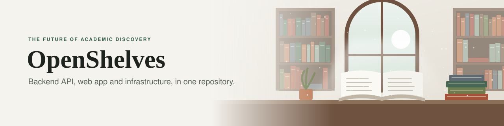
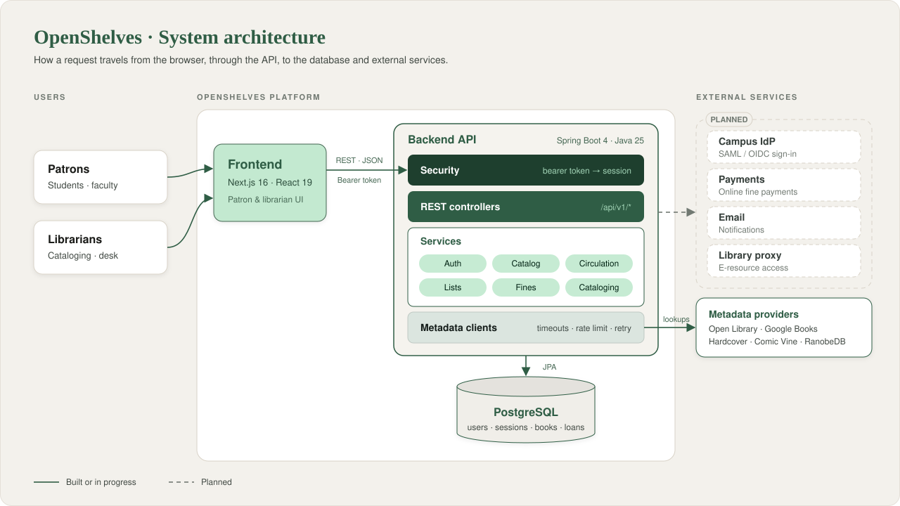

<p align="center">
  
</p>

<div align="center">

[](LICENSE)
[](https://spring.io/projects/spring-boot)
[](https://openjdk.org/)
[](https://nextjs.org/)
[](https://nodejs.org/)
[](https://www.postgresql.org/)
[](CONTRIBUTING.md)
[](CODE_OF_CONDUCT.md)

*Somewhere in every university, the answer to someone's question already sits on a shelf.*<br>
*OpenShelves exists so it can be found.*

</div>

Most university catalogs still feel like the 1990s: slow searches, cryptic records and a dozen separate portals. OpenShelves replaces that with one open platform where students find what they need, borrow it without queuing at a desk, and keep their research in one place, while librarians get a calm workspace to run it all.

> [!IMPORTANT]
> **Early days.** OpenShelves isn't ready for production yet.
> The foundations are going in now: sign-in, the catalog and borrowing come first.

---

## 🌟 Prologue · The vision

A library should be as easy to search as the web, and as trustworthy as the archive behind it.

- 🔎 **Find it in one search:** books, journals and digital resources in one place, with filters that make sense to a first-year student.
- 🧱 **Built to stay up:** a backend that keeps working through exam-week traffic and slow outside services.
- 🌍 **Open by design:** open code and open standards, so any university can run it, adapt it and trust it.

## ✨ The Shelves · What it does (planned)

| | Area | For |
|---|---|---|
| 🔎 | Catalog search, facets, new arrivals, recommendations | Patrons |
| 🔄 | Loans, renewals and holds | Patrons |
| 🗃️ | Reading lists (course syllabi, research folios) | Patrons, faculty |
| 💳 | Fines and online payments | Patrons |
| 💾 | Digital resources and journals | Patrons |
| 🛠️ | Cataloging from external metadata providers (Open Library, Google Books, …) | Librarians |
| 🔐 | Password and campus SSO (SAML / OIDC) sign-in | Everyone |

Each area maps to a group of endpoints; the full map is in the [API design](docs/api-design/README.md).

---

## 🏗️ The Blueprint · Architecture

Two apps and a database: a web app people use, an API that does the work, and PostgreSQL underneath.

<p align="center">
  
</p>

- 🔐 **Simple, revocable sessions:** the web app sends an opaque token with every call, and the API looks it up in PostgreSQL, so signing out of a device takes effect at once.
- 🧠 **One API, organised by feature:** auth, catalog, circulation, fines and cataloging live in one Spring Boot app, each in its own package.
- 🛡️ **Outside services can't drag it down:** every metadata provider has its own client with timeouts, rate limits and retries, so one slow provider never stalls the rest.

## 📁 The Stacks · Repository structure

Everything lives in this one repository.

| Path | What's in it |
|---|---|
| [`backend/`](backend) | REST API: Java 25, Spring Boot 4, PostgreSQL |
| [`frontend/`](frontend) | Web app: Next.js 16, React 19, TypeScript, Tailwind CSS 4 |
| [`infra/`](infra) | Infrastructure as Code *(not started)* |
| [`docs/`](docs) | API design, design system, user journeys, proofs of concept |

## 🛠️ The Craft · Technology stack

| Layer | Stack |
|---|---|
| ⚙️ Backend | Java 25 (Azul) · Spring Boot 4.1 (WebMVC, Data JPA, Security, Validation, Actuator) · Gradle |
| 🗄️ Database | PostgreSQL |
| 🛡️ Resilience & HTTP | Resilience4j · OkHttp 5 |
| 🖥️ Frontend | Next.js 16 (App Router) · React 19 · TypeScript (strict) · Tailwind CSS 4 |
| 🧪 Testing | JUnit 6 (Jupiter) |

---

## 🚀 First Pages · Getting started

Three steps to run it locally: a database, the API, then the web app.

### Prerequisites

- **Java 25** (Azul Zulu recommended)
- **Node.js 26** (pinned in [`frontend/.nvmrc`](frontend/.nvmrc))
- **PostgreSQL** (local install or Docker)

### 1. Database

```bash
createdb openshelves
psql -d openshelves -f backend/src/main/resources/schema.sql
psql -d openshelves -f backend/src/main/resources/seed.sql   # optional sample data
```

Connection settings (URL, user, password) are in [`backend/src/main/resources/application.yml`](backend/src/main/resources/application.yml).

### 2. Backend → http://localhost:8080

```bash
cd backend
./gradlew bootRun
```

Health check: `GET http://localhost:8080/actuator/health`

### 3. Frontend → http://localhost:3000

```bash
cd frontend
npm install
npm run dev
```

For configuration, project layout and conventions, see the [backend](backend/README.md) and [frontend](frontend/README.md) guides.

---

## 📚 Reading Guides · Documentation

Where to look before you change something.

| | Doc | What's in it |
|---|---|---|
| 🔌 | [API design](docs/api-design/README.md) | Every API group, endpoint and convention |
| 🎨 | [Design system](docs/Design%20System.md) | Colours, typography, components |
| 🖥️ | [Frontend architecture](docs/Frontend%20Architecture.md) | Folder structure, data flow, auth, API client |
| 🧭 | [User journey maps](docs/User%20Journey%20Maps.pdf) | How patrons and librarians move through the product |
| 🧪 | [Demo site](docs/poc/demo-site/README.md) | Frontend-only prototype the UI is based on |
| 🤖 | [AGENTS.md](AGENTS.md) | Instructions for AI coding assistants |

## 🤝 An Open Invitation · Contributing

The first pages are still being written, which makes now the best time to add yours. Developers, designers, librarians and anyone who has ever lost an afternoon to a library portal are all welcome.

- 📝 Start with the [contributing guide](CONTRIBUTING.md).
- 🏛️ Read [how the project is run](GOVERNANCE.md).
- 💛 Follow the [Code of Conduct](CODE_OF_CONDUCT.md).

## 📄 House Rules · Policies

The fine print, in one place.

- [AI Usage Policy](AI_USAGE_POLICY.md)
- [Security Policy](SECURITY.md)
- [Anti-Impersonation Policy](ANTI-IMPERSONATION.md)
- [Contributor License Agreement](CLA.md)
- [License: Business Source License 1.1](LICENSE)

---

<div align="center">

*Every great library began as a single shelf. This is ours.*

**© 2026 OpenShelves Labs** · Built with care for the academic community

</div>
