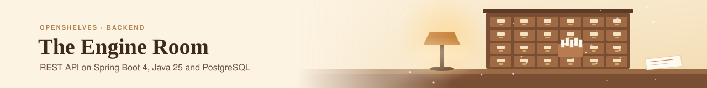
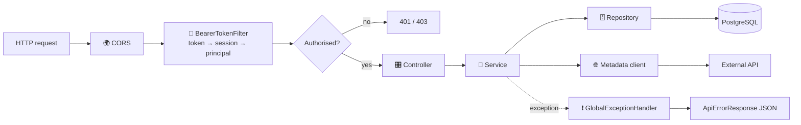

<p align="center">
  
</p>

*The archive no one sees, so the reading room never has to wait.*

[← Project README](../README.md)

This is the engine room of OpenShelves: the REST API behind every search, loan and sign-in. It's a single Spring Boot app on PostgreSQL, organised by feature, and it's the only part of the system that talks to the database or to outside metadata services.

New here? [Run it locally](#-running-locally) and sign in with the seeded user; it takes about five minutes.

**Contents**

1. [🛠️ Stack](#️-stack)
2. [🚀 Running locally](#-running-locally)
3. [⚙️ Configuration](#️-configuration)
4. [🧰 Gradle tasks](#-gradle-tasks)
5. [📁 Project layout](#-project-layout)
6. [🔄 How a request flows](#-how-a-request-flows)
7. [🗄️ Database](#️-database)
8. [🌐 External metadata providers](#-external-metadata-providers)
9. [✍️ Coding conventions](#️-coding-conventions)

---

## 🛠️ Stack

| | |
|---|---|
| ☕ Language | Java 25 (Azul) |
| 🌱 Framework | Spring Boot 4.1: WebMVC, Data JPA, Security, Validation, Actuator |
| 🗄️ Database | PostgreSQL |
| 🌐 HTTP client | OkHttp 5 |
| 🛡️ Resilience | Resilience4j (rate limiter, retry) |
| 🧩 Boilerplate | Lombok |
| 🧪 Tests | JUnit 6 (Jupiter) |
| 🏗️ Build | Gradle (wrapper included) |

---

## 🚀 Running locally

### 1. Prerequisites

- **Java 25.** Gradle's toolchain picks it up; `java -version` should report 25.
- **PostgreSQL**, reachable with the [default settings](#️-configuration) or your own.

### 2. Create the database

```bash
createdb openshelves
psql -d openshelves -f src/main/resources/schema.sql
psql -d openshelves -f src/main/resources/seed.sql   # sample data, local only
```

### 3. Run

```bash
./gradlew bootRun
```

The API is ready when the log shows `Started OpenShelvesApplication`, on **http://localhost:8080**.

### 4. Try it

```bash
# Health
curl http://localhost:8080/actuator/health

# Sign in with the seeded user (email or institutional ID)
curl -X POST http://localhost:8080/api/v1/auth/login \
  -H 'Content-Type: application/json' \
  -d '{"identifier":"admin@openshelves.local","password":"admin","persistent":false}'

# Use the returned token
curl http://localhost:8080/api/v1/auth/session -H 'Authorization: Bearer <token>'
```

| Seeded user | Value |
|---|---|
| Email | `admin@openshelves.local` |
| Institutional ID | `ADMIN001` |
| Password | `admin` |

---

## ⚙️ Configuration

Every setting lives in [`src/main/resources/application.yml`](src/main/resources/application.yml). You can override any of them with an environment variable, so your local passwords never need to be committed:

| Setting | Default | Env var |
|---|---|---|
| `server.port` | `8080` | `SERVER_PORT` |
| `spring.datasource.url` | `jdbc:postgresql://localhost:5432/openshelves` | `SPRING_DATASOURCE_URL` |
| `spring.datasource.username` | `admin` | `SPRING_DATASOURCE_USERNAME` |
| `spring.datasource.password` | `admin123` | `SPRING_DATASOURCE_PASSWORD` |
| `spring.cors.allowed-origins` | `http://localhost:3000` | `SPRING_CORS_ALLOWED_ORIGINS` |

```bash
SPRING_DATASOURCE_PASSWORD=secret ./gradlew bootRun
```

Other defaults worth knowing:

- 🕒 Hibernate stores timestamps in **UTC**.
- 🧾 JSON responses **omit `null` fields** and requests **ignore unknown fields**.
- 🔍 Logging is `DEBUG` for `com.openshelves`, `INFO` for everything else.

---

## 🧰 Gradle tasks

| Command | What it does |
|---|---|
| `./gradlew bootRun` | Run the API |
| `./gradlew test` | Run the tests |
| `./gradlew build` | Compile, test and build the jar into `build/libs/` |
| `./gradlew dependencyUpdates` | List newer **stable** versions of dependencies |
| `./gradlew downloadDependencies` | Pre-fetch all dependencies (e.g. for offline work or CI caching) |

Build cache, configuration cache and parallel builds are on by default ([`gradle.properties`](gradle.properties)).

---

## 📁 Project layout

Code is organised **by feature**, with a small shared `common` package.

```
src/main/java/com/openshelves/
├── OpenShelvesApplication.java
│
├── security/                   🔐 Sign-in, sessions, bearer-token auth
│   ├── controller/             AuthController (/api/v1/auth)
│   ├── services/               AuthService, TokenService, PasswordService, LockoutService
│   ├── filter/                 BearerTokenFilter
│   ├── entity/                 User, UserCredential, UserSession
│   ├── repository/
│   ├── model/                  Request / response DTOs
│   └── enums/
│
├── metadata/                   🌐 External book metadata providers
│   ├── client/                 MetadataClient interface + registry
│   │   └── impl/               openlibrary, googlebooks, hardcover, comicvine, ranobedb
│   ├── model/                  BookMetadata, AuthorMetadata, BookRequest, FetchOptions
│   └── enums/
│
└── common/                     🧱 Shared across features
    ├── config/                 Security, CORS, async, JPA auditing, HTTP clients
    ├── exception/              GlobalExceptionHandler, GlobalErrorController
    ├── model/                  ApiErrorResponse, SessionPrincipal
    └── entity/                 BaseEntity

src/main/resources/
├── application.yml
├── schema.sql                  🗄️ Database schema
├── seed.sql                    🌱 Local sample data
└── banner.txt
```

| Package convention | Holds |
|---|---|
| `controller` | REST endpoints only; no logic |
| `services` | Business logic |
| `repository` | Spring Data JPA repositories |
| `entity` | JPA entities (suffix `Entity`) |
| `model` | Request / response DTOs |

> 📝 `src_bak/` is the previous backend, kept for reference. Gradle doesn't compile it.

---

## 🔄 How a request flows



- 🔐 **Auth** is stateless: every request carries `Authorization: Bearer <token>`. The filter hashes the token and looks up an active session. Only `POST /api/v1/auth/login` and `/actuator/health` are public.
- ❗ **Errors** always come back as one JSON shape (`ApiErrorResponse`: RFC 9457 problem details plus a machine-readable `code`).
- 📐 The full API design, including endpoints not built yet, is in [`docs/api-design`](../docs/api-design/README.md).

---

## 🗄️ Database

- The schema is [`schema.sql`](src/main/resources/schema.sql); Hibernate only **validates** against it (`ddl-auto: validate`), never changes it.
- Apply `schema.sql` (and optionally `seed.sql`) by hand, as in [Running locally](#-running-locally).
- Lookup tables are prefixed `lu_` (e.g. `lu_author_roles`, `lu_user_credential_types`).

> 📝 **Note:** `application.yml` enables Flyway (`classpath:db/migration`), but there's no Flyway dependency or migrations folder yet. Until there is, schema changes go in `schema.sql`.

---

## 🌐 External metadata providers

When a librarian catalogs a new book, the API asks these services for its details, so nobody types a record by hand. Lookups work by ISBN, title or author.

| Provider | Package | Good for |
|---|---|---|
| Open Library | `impl/openlibrary` | General books, open data |
| Google Books | `impl/googlebooks` | General books, descriptions, covers |
| Hardcover | `impl/hardcover` | Community metadata |
| Comic Vine | `impl/comicvine` | Comics and graphic novels |
| RanobeDB | `impl/ranobedb` | Light novels |

Each provider has the same four pieces:

```
impl/<provider>/
├── <Provider>Client.java        implements MetadataClient
├── <Provider>Mapper.java        provider JSON → BookMetadata / AuthorMetadata
├── <Provider>Interceptor.java   rate limiting + retries (Resilience4j)
└── <Provider>Config.java        dedicated OkHttpClient (timeouts, pool, interceptor)
```

**Adding a provider** takes two steps: add a `MetadataProvider` enum value, then create those four classes. `MetadataClientRegistry` finds every `MetadataClient` bean on its own, and refuses to start if two claim the same provider.

---

## ✍️ Coding conventions

The full rules are in [`AGENTS.md`](../AGENTS.md). In short:

- 🧩 **Lombok first:** `@Value` + `@Builder(setterPrefix = "with")` + `@Jacksonized` for DTOs; `@RequiredArgsConstructor` for injection.
- 💉 **Constructor injection only**, never `@Autowired` fields.
- 📝 **Markdown doc comments** (`///`) on classes and public methods.
- 🛡️ **Wrap external calls** with Resilience4j.
- 🧪 **Test new business logic** with JUnit (tests go in `src/test/java`).
- 📦 **No new dependencies** without agreement; stick to the Spring Boot BOM.

---

<div align="center">

*Quiet, careful work in the back room, so the front desk never keeps anyone waiting.*

[← Back to the project README](../README.md)

</div>
