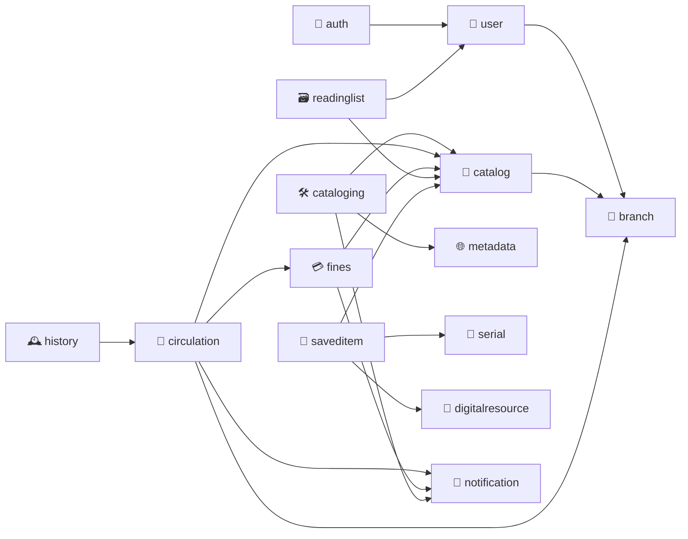

# 📦 Backend Package Structure

*Every book has its shelf, and every shelf its room.*

> How the Spring Boot backend is split into packages: one package per domain, each with the same layers inside.
> This is the **target** layout, worked out from the [API design](api-design/README.md). Today's layout is in [`backend/README.md`](../backend/README.md#-project-layout).

**Contents**

1. [🧭 The idea](#-the-idea)
2. [🌳 The tree](#-the-tree)
3. [🧱 Layers inside a domain](#-layers-inside-a-domain)
4. [🔗 How the domains depend on each other](#-how-the-domains-depend-on-each-other)
5. [🤔 Why this shape](#-why-this-shape)
6. [🚚 Moving from today's layout](#-moving-from-todays-layout)

---

## 🧭 The idea

- 🗂️ **Domain first, layer second.** The top-level packages are the things the library does (catalog, circulation, fines…), not the technical layers. Everything about loans lives under `circulation/`.
- 📐 **One domain per API group**, with a few exceptions explained [below](#-why-this-shape).
- 🧩 **Same layers everywhere**, and only the ones a domain needs. A domain with no table has no `entity/` or `repository/`.

---

## 🌳 The tree

```
src/main/java/com/openshelves/
├── OpenShelvesApplication.java
│
│   ─────────────────────────────  🧱 Foundations  ─────────────────────────────
│
├── common/                          Shared across every domain
│   ├── config/                      SecurityConfig, AsyncConfig, JpaAuditConfig, RestClientConfig
│   ├── email/                       EmailSender, LoggingEmailSender
│   ├── entity/                      BaseEntity
│   ├── exception/                   GlobalExceptionHandler, GlobalErrorController, ThirdPartyClientException
│   ├── filter/                      RateLimitFilter, RateLimitProperties
│   ├── model/                       ApiErrorResponse, SessionPrincipal
│   └── util/                        CipherUtils, FrontendUrlValidator
│
├── user/                            👤 02 · The member: profile and settings       /profile, /settings
│   ├── controller/                  ProfileController, SettingsController
│   ├── services/                    ProfileService, SettingsService
│   ├── entity/                      UserEntity
│   ├── repository/                  UserRepository
│   ├── model/                       ProfileResponse, UpdateProfileRequest, SettingsResponse, UpdateSettingsRequest
│   └── exception/                   FieldNotEditableException
│
├── auth/                            🔐 01 · Sign-in, sessions, devices, SSO        /auth
│   ├── controller/                  AuthController, DeviceController, SsoSignInController,
│   │                                LinkedIdentityController, PasswordController
│   ├── services/                    AuthService, TokenService, DeviceService, LockoutService,
│   │                                PasswordService, UserPasswordService, SsoService,
│   │                                SsoCallbackHandler, SsoCookieStore,
│   │                                IdentityProviderService, LinkedIdentityService
│   ├── filter/                      BearerTokenFilter
│   ├── entity/                      UserSessionEntity, UserPasswordEntity, UserIdentityEntity,
│   │                                AuthProviderEntity, SsoCodeEntity, PasswordResetTokenEntity
│   ├── repository/                  One per entity above
│   ├── model/                       LoginRequest, LoginResponse, SessionResponse, DeviceResponse, …
│   ├── enums/                       AuthProviderType, SsoCodePurpose
│   └── exception/                   IdentityInUseException, IdentityNotLinkedException,
│                                    LastSignInMethodException, …
│
├── branch/                          🏢 Library branches (reference data)           /branches
│   ├── controller/                  BranchController
│   ├── services/                    BranchService
│   ├── entity/                      BranchEntity
│   ├── repository/                  BranchRepository
│   └── model/                       BranchResponse
│
│   ─────────────────────────────  📚 The collection  ──────────────────────────
│
├── catalog/                         🔎 03 · Books, contributors, copies            /books, /catalog
│   ├── controller/                  BookController, CatalogStatsController
│   ├── services/                    BookSearchService, BookService, RecommendationService,
│   │                                AvailabilityService
│   ├── entity/                      BookEntity, AuthorEntity, BookAuthorEntity, CopyEntity
│   ├── repository/                  BookRepository, AuthorRepository, CopyRepository
│   ├── model/                       BookSummary, BookDetail, CopyResponse, Availability, SearchFacets
│   └── enums/                       AvailabilityStatus, CopyStatus, ResourceType, ContributorRole
│
├── cataloging/                      🛠️ 12 · Librarian tools: lookup, add, edit     /admin
│   ├── controller/                  MetadataProviderController, CatalogingLookupController,
│   │                                AdminBookController
│   ├── services/                    LookupService, RecordMergeService, AdminBookService
│   ├── model/                       LookupResponse, ProposedRecord, BookRecordRequest
│   └── exception/                   DuplicateIdentifierException, ProvidersUnavailableException
│
├── metadata/                        🌐 External metadata providers (used by cataloging)
│   ├── client/                      MetadataClient, MetadataClientRegistry
│   │   └── impl/                    openlibrary/, googlebooks/, hardcover/, comicvine/, ranobedb/
│   ├── model/                       BookMetadata, AuthorMetadata, BookRequest, FetchOptions
│   └── enums/                       MetadataProvider, MetadataField, AuthorRole
│
├── digitalresource/                 💾 10 · E-book platforms, databases, datasets  /digital-resources
│   ├── controller/                  DigitalResourceController
│   ├── services/                    DigitalResourceService, AccessService
│   ├── entity/                      DigitalResourceEntity
│   ├── repository/                  DigitalResourceRepository
│   ├── model/                       DigitalResourceResponse, AccessResponse
│   └── enums/                       DigitalResourceType, AccessType
│
├── serial/                          📰 11 · Journals, ISSN lookup                  /serials
│   ├── controller/                  SerialController
│   ├── services/                    SerialService
│   ├── entity/                      SerialEntity
│   ├── repository/                  SerialRepository
│   └── model/                       SerialResponse
│
│   ─────────────────────────────  🔄 The patron's account  ────────────────────
│
├── circulation/                     🔄 04 · Loans, renewals, holds, standing       /loans, /holds, /borrowing-status
│   ├── controller/                  LoanController, HoldController, BorrowingStatusController
│   ├── services/                    LoanService, RenewalService, HoldService, BorrowingStatusService
│   ├── entity/                      LoanEntity, HoldEntity
│   ├── repository/                  LoanRepository, HoldRepository
│   ├── model/                       LoanResponse, RenewAllResponse, HoldResponse, PlaceHoldRequest,
│   │                                BorrowingStatus
│   ├── enums/                       LoanKind, HoldStatus, Standing
│   └── exception/                   RenewalLimitReachedException, HoldExistsException,
│                                    AccountRestrictedException, …
│
├── history/                         🕰️ 08 · Past borrowings, yearly summary        /history
│   ├── controller/                  HistoryController
│   ├── services/                    HistoryService                 (reads returned loans; no table of its own)
│   └── model/                       HistoryEntry, YearlySummary
│
├── fines/                           💳 07 · Fines and payments                     /fines, /payments
│   ├── controller/                  FineController, PaymentController
│   ├── services/                    FineService, PaymentService
│   ├── entity/                      FineEntity, PaymentEntity
│   ├── repository/                  FineRepository, PaymentRepository
│   ├── model/                       FineResponse, FineSummary, PaymentRequest, PaymentResponse, Money
│   ├── enums/                       FineReason, FineStatus, PaymentMethod, PaymentStatus
│   └── exception/                   FineNotPayableException, AmountChangedException
│
├── readinglist/                     🗃️ 05 · Folios: lists and their items          /reading-lists
│   ├── controller/                  ReadingListController, ReadingListItemController
│   ├── services/                    ReadingListService, ReadingListItemService
│   ├── entity/                      ReadingListEntity, ReadingListItemEntity, ListCollaboratorEntity
│   ├── repository/                  One per entity above
│   ├── model/                       ReadingListSummary, ReadingListDetail, ItemRequest, RecentItem
│   ├── enums/                       ListCategory, Visibility, CollaboratorRole
│   └── exception/                   AlreadyInListException
│
├── saveditem/                       🔖 06 · Bookmarks across item types            /saved-items
│   ├── controller/                  SavedItemController
│   ├── services/                    SavedItemService
│   ├── entity/                      SavedItemEntity
│   ├── repository/                  SavedItemRepository
│   ├── model/                       SavedItemResponse, SavedItemIds
│   └── enums/                       SavedItemType
│
└── notification/                    🔔 09 · The bell: feed, unread count           /notifications
    ├── controller/                  NotificationController
    ├── services/                    NotificationService            (other domains call it to create notifications)
    ├── entity/                      NotificationEntity
    ├── repository/                  NotificationRepository
    ├── model/                       NotificationResponse, UnreadCount
    └── enums/                       NotificationKind, NotificationCategory
```

> 📝 Class names for domains not built yet are a starting point, taken from the API design. Rename freely when you build them.

---

## 🧱 Layers inside a domain

| Package | Holds |
|---|---|
| `controller/` | REST endpoints only; no logic |
| `services/` | Business logic |
| `repository/` | Spring Data JPA repositories |
| `entity/` | JPA entities (suffix `Entity`) |
| `model/` | Request / response DTOs |
| `enums/` | Enums used by the domain's entities and DTOs |
| `exception/` | The domain's own exceptions, each mapped to an error `code` |
| `filter/` | Servlet filters (only `auth` has one) |

---

## 🔗 How the domains depend on each other

An arrow means *uses*. There are no cycles: a domain never reaches back up the chain.



- `common` is used by everyone and uses no domain.
- `notification` is used by others to create notifications, and depends on none of them.

---

## 🤔 Why this shape

| | Choice | Why |
|---|---|---|
| 👤 | **`user` is separate from `auth`** | Profile and settings own `UserEntity`. `auth` only signs a user in, so it depends on `user`, never the other way round. |
| 🔐 | **`security` becomes `auth`** | Matches `/auth` and [01. Auth & Sessions](api-design/01-auth-sessions.md). |
| 🏢 | **`branch` is its own small domain** | Copies (catalog), holds (circulation) and the default pickup branch (settings) all point at branches. Inside `circulation`, as the API groups it, catalog and circulation would depend on each other. |
| 🛠️ | **`cataloging` is separate from `catalog`** | Staff writing records vs patrons reading them; different rules and a staff role. Both share the same `BookEntity` from `catalog`. |
| 🌐 | **`metadata` stays its own package** | It's an integration, not a feature. Only `cataloging` uses it. |
| 🕰️ | **`history` has no entity** | History is returned loans, read through `circulation` ([08](api-design/08-reading-history.md)). |

---

## 🚚 Moving from today's layout

| Today | Moves to |
|---|---|
| `security/*` | `auth/*` |
| `security/entity/UserEntity` | `user/entity/UserEntity` |
| `security/repository/UserRepository` | `user/repository/UserRepository` |
| `common/*`, `metadata/*` | Unchanged |

Everything else is new and gets created as each API group is built, in the [build order](api-design/README.md#-how-the-groups-depend-on-each-other): 01 → 02 → 03 → 04 → 05, then the rest.

---

<div align="center">

*A well-kept library is one where you always know which room to walk into.*

[← Back to the docs](README.md)

</div>
