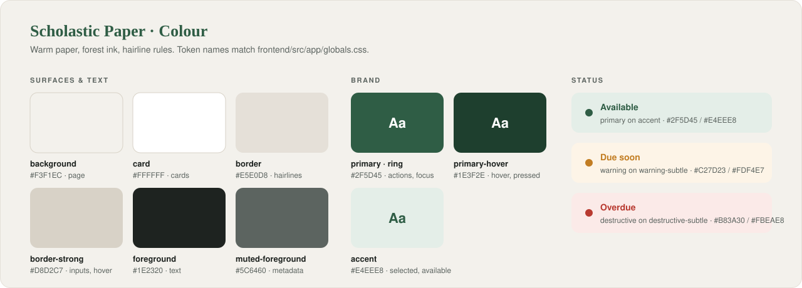

# 🎨 OpenShelves Design System · *Scholastic Paper*

*Paper remembers what screens forget: be quiet, be legible, be kind to tired eyes.*

> The look of an archival reading room: warm paper, forest-green ink, hairline rules, and editorial type.
> Calm and dense enough for long research sessions; never flashy.

> [!NOTE]
> **Source of truth:** the tokens are implemented in [`frontend/src/app/globals.css`](../frontend/src/app/globals.css) (Tailwind 4 `@theme`). This doc explains them and how to use them. **Change both together.**

**Contents**

1. [🧭 Principles](#-principles)
2. [🎨 Colour](#-colour)
3. [🔤 Typography](#-typography)
4. [📐 Layout & spacing](#-layout--spacing)
5. [⬜ Shape](#-shape)
6. [🪶 Elevation & borders](#-elevation--borders)
7. [🎯 Interaction states](#-interaction-states)
8. [🔣 Icons](#-icons)
9. [🧩 Components](#-components)

---

## 🧭 Principles

| | Principle | In practice |
|---|---|---|
| 📜 | **Paper, not glass** | White cards on a warm paper background. No gradients, no glow. |
| ✒️ | **Ink for meaning** | Forest green marks what's actionable or confirmed. Everything else is charcoal and stone. |
| 📏 | **Hairlines over shadows** | Separate things with 1px warm borders. Shadows only for things that float. |
| 📖 | **Editorial type** | Serif for titles of works and headings; sans for the interface. |
| 🗂️ | **Dense but calm** | Catalog data is rich; give it clear hierarchy and room, not decoration. |

---

## 🎨 Colour

<p align="center">
  
</p>

### Tokens

Use the **Tailwind class**, never the raw hex.

| Token | Hex | Tailwind | Use for |
|---|---|---|---|
| `background` | `#F3F1EC` | `bg-background` | Page canvas, sidebar, top bar |
| `foreground` | `#1E2320` | `text-foreground` | Body text, headings |
| `muted-foreground` | `#5C6460` | `text-muted-foreground` | Metadata, captions, call numbers, timestamps, placeholders |
| `card` | `#FFFFFF` | `bg-card` | Cards, inputs, menus, modals |
| `card-foreground` | `#1E2320` | `text-card-foreground` | Text on cards |
| `border` | `#E5E0D8` | `border-border` | Hairlines, dividers, card edges |
| `border-strong` | `#D8D2C7` | `border-border-strong` | Inputs, secondary buttons, hover edges |
| `ring` | `#2F5D45` | `outline-ring` | Focus ring |
| `primary` | `#2F5D45` | `bg-primary` · `text-primary` | Primary actions, links, active nav, "available" |
| `primary-foreground` | `#FFFFFF` | `text-primary-foreground` | Text on primary |
| `primary-hover` | `#1E3F2E` | `hover:bg-primary-hover` | Hover / pressed primary; dark emphasis |
| `accent` | `#E4EEE8` | `bg-accent` | Selected chips, active rows, "available" background |
| `accent-foreground` | `#2F5D45` | `text-accent-foreground` | Text on accent |
| `warning` / `warning-subtle` | `#C27D23` / `#FDF4E7` | `text-warning` · `bg-warning-subtle` | Due soon, action needed |
| `destructive` / `destructive-subtle` | `#B83A30` / `#FBEAE8` | `text-destructive` · `bg-destructive-subtle` | Overdue, fines, errors, destructive actions |

### Status colours

Always a **pair**: strong colour for text / icon / dot, subtle colour for the background.

| Status | Text / dot | Background | Examples |
|---|---|---|---|
| 🟢 Success | `primary` | `accent` | Available, renewed, paid, hold ready |
| 🟠 Warning | `warning` | `warning-subtle` | Due in 3 days, action needed |
| 🔴 Critical | `destructive` | `destructive-subtle` | Overdue, fine outstanding, failed |
| ⚪ Neutral | `muted-foreground` | `background` | Checked out, on order, archived |

> ♿ Don't rely on colour alone: pair status colour with a label or icon ("Overdue", not just a red dot).

---

## 🔤 Typography

| Font | Role | Tailwind |
|---|---|---|
| **Literata** (serif) | Editorial voice: page titles, headings, titles of books / journals / theses, quotations | `font-serif` (headings get it automatically) |
| **DM Sans** (sans) | Interface: navigation, forms, tables, filters, metadata | `font-sans` (default) |

### Scale

| Token | Size / line | Weight | Font | Use for |
|---|---|---|---|---|
| `display-lg` | 48 / 56 | 500 | Serif | Landing / hero titles |
| `headline-lg` | 32 / 40 | 600 | Serif | Page titles |
| `headline-md` | 24 / 32 | 600 | Serif | Section titles |
| `headline-sm` | 20 / 28 | 600 | Serif | Card titles, book titles in lists |
| `title` | 18 / 26 | 500 | Serif | Sub-headings, quotations, book titles in compact cards |
| `body-lg` | 17 / 28 | 400 | Sans | Abstracts, long reading |
| `body-md` | 15 / 24 | 400 | Sans | Default body text |
| `body-sm` | 13 / 20 | 400 | Sans | Secondary text, table cells |
| `label-lg` | 14 / 20 | 600 | Sans | Buttons, nav items, form labels |
| `label-md` | 12 / 16 | 500 | Sans | Chips, small buttons, badges |
| `caps` | 11 / 14 | 600 | Sans + `uppercase` | Section eyebrows, call numbers, catalog tags |

Use as `text-<token>`, e.g. `text-headline-md font-serif`, `text-caps uppercase`.

### Rules

- 📚 **Titles of works** (books, journals, theses) are always **serif**, in normal case.
- 🏷️ **`caps`** is always uppercase with its tracking: `DEWEY 577.18`, `NEW ARRIVAL`, `LC: QH541`.
- 🔢 Use `tabular-nums` for numbers that line up: due dates, amounts, counts, barcodes.
- 📏 Keep long text to about 70 characters per line (`max-w-prose`).

---

## 📐 Layout & spacing

### App shell

```
┌────────────┬──────────────────────────────────────────────────┐
│            │  Top bar · 64px · search, notifications, profile │
│  Sidebar   ├──────────────────────────────────────────────────┤
│  256px     │                                                  │
│            │   Content · padding 32px · max-width 1600px      │
│  nav       │                                                  │
│  sections  │                                                  │
│            │                                                  │
└────────────┴──────────────────────────────────────────────────┘
          all on bg-background, separated by border-border
```

| Part | Size | Tailwind |
|---|---|---|
| Sidebar | 256px, fixed, full height | `w-64` |
| Top bar | 64px, sticky, translucent paper | `h-16 bg-background/90 backdrop-blur-sm` |
| Content | 32px side padding, max 1600px | `px-8 max-w-[1600px]` |

### Spacing

Tailwind's 4px scale. Stick to these steps:

| Step | px | Typical use |
|---|---|---|
| `1` · `1.5` · `2` | 4 · 6 · 8 | Icon-to-label gaps, chip padding |
| `3` · `4` | 12 · 16 | Inside compact rows, gaps between controls |
| `5` · `6` | 20 · 24 | Card padding |
| `8` | 32 | Page padding, gaps between sections |
| `10` · `14` | 40 · 56 | Large section breaks |

### Breakpoints

| Width | Layout |
|---|---|
| ≥ 1280px (`xl`) | Sidebar + facet column + results |
| 768 – 1279px (`md`) | Sidebar; facets collapse into a drawer or tabs |
| < 768px | No sidebar (menu button); cards stack in one column |

---

## ⬜ Shape

| Radius | px | Tailwind | Use for |
|---|---|---|---|
| Small | 4 | `rounded` | Status chips, tags, checkboxes |
| Default | 8 | `rounded-lg` | Buttons, inputs, menus, list rows |
| Card | 12 | `rounded-xl` | Cards, search bar, panels |
| Large | 16 | `rounded-2xl` | Modals, large workspace panels |
| Pill | full | `rounded-full` | Filter chips, avatars, counts, toggle pills |

📕 **Book covers** keep a 2:3 ratio (`aspect-[2/3]`) with `rounded-md` (6px).

---

## 🪶 Elevation & borders

Depth comes from **paper layering**, not shadows.

| Layer | How |
|---|---|
| 📄 Page | `bg-background` |
| 🗂️ Card / panel | `bg-card border border-border rounded-xl` |
| 🖱️ Hover | Border to `border-border-strong` (or `border-primary` when selected). No lift, no shadow. |
| 🪟 Floating (menus, popovers, modals, toasts) | `shadow-overlay` + `border border-border-strong` |
| 🌫️ Modal backdrop | `bg-foreground/30` |

---

## 🎯 Interaction states

| State | Treatment |
|---|---|
| 🎯 **Focus** | 1.5px `ring` outline, 2px offset (paper gap). Global in `globals.css`; don't remove it. |
| 🖱️ **Hover** | Primary: `bg-primary-hover`. Secondary / cards: `border-border-strong`, text to `primary`. Rows: `bg-background`. |
| ✅ **Selected** | `bg-accent text-accent-foreground`, plus `border-primary` where there's a border. |
| ⏳ **Loading** | Keep the size; swap the icon for a spinning `progress_activity`, disable the control. |
| 🚫 **Disabled** | `opacity-50 cursor-not-allowed`; no hover change. |

---

## 🔣 Icons

- **Material Symbols Outlined**, from the `material-symbols` package.
- Default is the outline glyph; add `.fill` for the filled one (e.g. a saved bookmark).
- Sizes: **20px** in nav and buttons, **16–18px** inline with text, **24px** standalone.
- Icons inherit text colour; colour them with the same tokens as text.

```html
<span class="material-symbols-outlined text-[20px]">bookmark</span>
<span class="material-symbols-outlined fill text-[20px] text-primary">bookmark</span>
```

---

## 🧩 Components

Recipes use the tokens above. Heights: **40px** default (`h-10`), **36px** compact (`h-9`), **44px** prominent (`h-11`).

### Buttons

| Variant | Classes | When |
|---|---|---|
| 🟩 Primary | `h-10 px-5 rounded-lg bg-primary text-primary-foreground text-label-lg hover:bg-primary-hover` | The main action on a page or card: Place hold, Renew, Pay |
| ⬜ Secondary | `h-10 px-5 rounded-lg bg-card border border-border-strong text-foreground text-label-lg hover:border-primary hover:text-primary` | Other actions: Cite, Add to list |
| 🔗 Ghost | `h-10 px-3 rounded-lg text-primary text-label-lg hover:bg-accent` | Low-emphasis actions, "View all" |
| 🟥 Destructive | Secondary shape with `text-destructive hover:border-destructive` | Cancel hold, delete list |

One primary button per area.

### Inputs & search

- `h-10 px-3.5 rounded-lg bg-card border border-border-strong text-body-md placeholder:text-muted-foreground`
- Focus: `focus:border-primary` (plus the global focus ring).
- The global search in the top bar is `rounded-xl` with a leading search icon.

### Chips

| Kind | Classes |
|---|---|
| Filter chip | `h-8 px-3 rounded-full bg-card border border-border text-label-md` |
| Filter chip, selected | `bg-accent text-accent-foreground border-primary` |
| Status chip | `px-2 py-0.5 rounded text-label-md` + status pair, optional 6px dot |
| Metadata tag | `px-2 py-0.5 rounded bg-background text-muted-foreground text-caps uppercase` |

### Cards

- `bg-card border border-border rounded-xl p-5` (compact rows: `p-4`).
- Book card: 2:3 cover on the left, serif title (`text-headline-sm` or `text-title`), contributors and metadata in `text-body-sm text-muted-foreground`, status chip, actions at the bottom.
- Hover: `hover:border-border-strong`. No lift.

### Checkboxes & radios

18px; `rounded` (checkbox) or `rounded-full` (radio); `border-border-strong` on `bg-card`. Checked: `bg-primary` with a white tick.

### Citation / quotation block

`border-l-[3px] border-primary bg-background pl-4 py-2 font-serif text-title`
