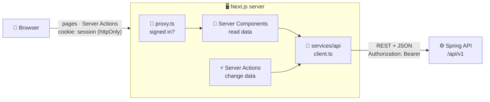
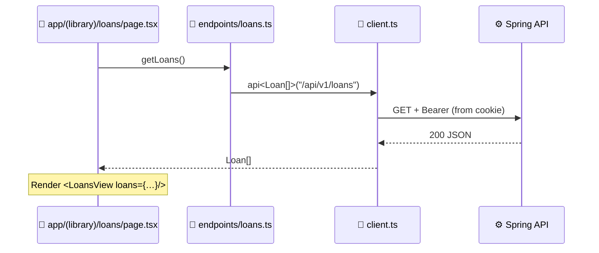
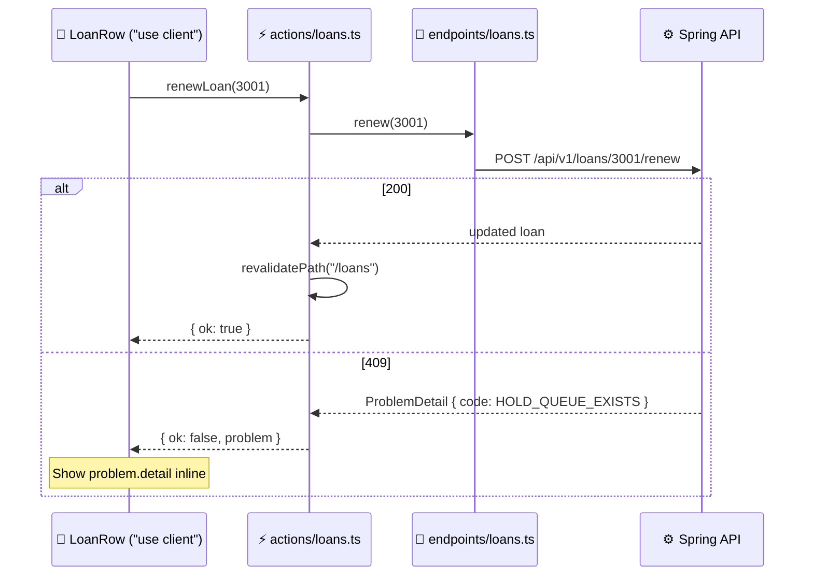
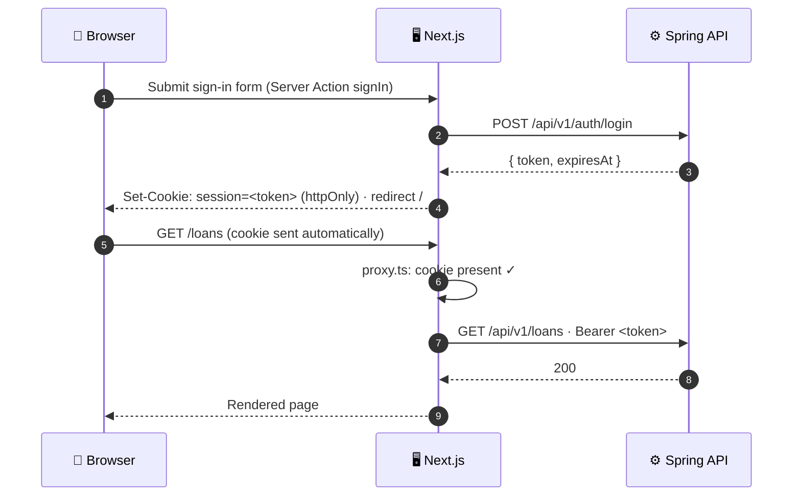

# 🖥️ Frontend Architecture

*A reading room is only as calm as the corridors behind it.*

> How the Next.js app is organised, where code runs, and how it talks to the backend.
> Setup and scripts are in [`frontend/README.md`](../frontend/README.md); look and feel in the [Design System](Design%20System.md); endpoints in the [API design](api-design/README.md).

**Contents**

1. [🧭 Big picture](#-big-picture)
2. [📁 Folder structure](#-folder-structure)
3. [📏 Rules](#-rules)
4. [🔄 Data flow](#-data-flow)
5. [🔐 Auth & session](#-auth--session)
6. [🔌 API client](#-api-client)
7. [❗ Error handling](#-error-handling)
8. [🧩 Server vs client components](#-server-vs-client-components)
9. [🏷️ Naming](#️-naming)
10. [🤔 Open decisions](#-open-decisions)

---

## 🧭 Big picture

The Next.js server sits **between the browser and the Spring API** (a "backend for frontend").
The browser never sees the API token or the backend URL.



| Where | Runs | Knows the token? |
|---|---|---|
| 🧑 Browser | Client components (`"use client"`) | ❌ Never |
| 🚦 `proxy.ts` | Before every matched request | Only checks the cookie exists |
| 🧩 Server Components, ⚡ Server Actions | Next.js server | ✅ Reads it from the `session` cookie |
| 🔌 `services/api/` | Next.js server only | ✅ Adds it as `Authorization: Bearer` |

---

## 📁 Folder structure

Organised **by layer**, with feature subfolders inside `components/`.

```
frontend/src/
├── proxy.ts                     🚦 Redirects to /sign-in when there's no session cookie
│
├── app/                         🧭 Routing only
│   ├── layout.tsx               Root layout (html, body, fonts)
│   ├── globals.css              Design tokens (see Design System)
│   ├── (auth)/
│   │   └── sign-in/page.tsx
│   ├── (library)/               Patron area: app shell with sidebar + top bar
│   │   ├── layout.tsx           Loads GET /auth/session, renders the shell
│   │   ├── page.tsx             Home
│   │   ├── catalog/  [id]/  new-arrivals/
│   │   ├── loans/  fines/  history/
│   │   ├── lists/  [id]/
│   │   ├── journals/  digital-resources/
│   │   └── profile/  settings/
│   ├── (admin)/admin/           Librarian tools
│   │   └── add-resource/
│   ├── error.tsx                Fallback for unexpected errors
│   └── not-found.tsx
│
├── components/                  🧩 UI
│   ├── ui/                      Generic, app-agnostic: Button, Input, Modal, Chip, Pagination
│   ├── layout/                  App shell: Sidebar, TopBar, ProfileMenu
│   └── <feature>/               One folder per feature: catalog/, loans/, lists/, fines/ …
│
├── actions/                     ⚡ Server Actions ("use server"), one file per API group
│   ├── auth.ts                  signIn, signOut
│   └── loans.ts                 renewLoan, renewAll …
│
├── services/
│   └── api/                     🔌 The only code that calls the backend (server-only)
│       ├── client.ts            api<T>(): base URL, bearer token, JSON, errors
│       ├── errors.ts            ApiError (wraps ProblemDetail)
│       ├── session.ts           Session cookie: name, options, get / set / clear
│       └── endpoints/           One file per API group: auth.ts, books.ts, loans.ts …
│
├── lib/                         🧰 Pure helpers, no I/O: dates, money, citations, query strings
│
└── types/                       🏷️ Backend shapes
    ├── pagination.ts            Page<T>, PageRequest   ✅ exists
    ├── problem-detail.ts        ProblemDetail          ✅ exists
    └── <group>.ts               One file per API group: book.ts, loan.ts …
```

### 🗺️ Routes ↔ API groups

| Route | Feature folder | Endpoint file | API group |
|---|---|---|---|
| `/sign-in` | `components/auth/` | `endpoints/auth.ts` | [01 Auth](api-design/01-auth-sessions.md) |
| `/profile`, `/settings` | `components/profile/` | `endpoints/profile.ts` | [02 Profile & Settings](api-design/02-profile-settings.md) |
| `/catalog`, `/catalog/[id]`, `/new-arrivals` | `components/catalog/` | `endpoints/books.ts` | [03 Catalog](api-design/03-catalog-discovery.md) |
| `/loans` | `components/loans/` | `endpoints/loans.ts`, `holds.ts` | [04 Circulation](api-design/04-circulation.md) |
| `/lists`, `/lists/[id]` | `components/lists/` | `endpoints/reading-lists.ts` | [05 Reading Lists](api-design/05-reading-lists.md) |
| `/fines` | `components/fines/` | `endpoints/fines.ts` | [07 Fines](api-design/07-fines-payments.md) |
| `/history` | `components/history/` | `endpoints/history.ts` | [08 History](api-design/08-reading-history.md) |
| `/digital-resources` | `components/digital/` | `endpoints/digital-resources.ts` | [10 Digital](api-design/10-digital-resources.md) |
| `/journals` | `components/journals/` | `endpoints/serials.ts` | [11 Serials](api-design/11-journals-serials.md) |
| `/admin/add-resource` | `components/admin/` | `endpoints/admin.ts` | [12 Cataloging](api-design/12-admin-cataloging.md) |

Notifications ([09](api-design/09-notifications.md)) and saved items ([06](api-design/06-saved-items.md)) have no page of their own; they live in the shell (`components/layout/`) and on cards.

---

## 📏 Rules

| | Rule | Why |
|---|---|---|
| 🧭 | **`app/` is routing only.** Pages fetch data and compose components; no business logic. | Pages stay readable; logic is reusable. |
| 🔌 | **Only `services/api/` talks to the backend.** Components never call `fetch` on the API. | One place for base URL, token and errors. |
| 🔒 | **Server-only files start with `import "server-only";`** (`services/api/*`, `actions/*` are server by nature). | A wrong import fails the build instead of leaking the token. |
| 🏷️ | **Types are plain `interface` / `type`** in `types/`, imported with `import type`. | Data crossing server → client is serialised; types are a leaf with no imports. |
| 📦 | **No barrel files** (`index.ts` re-exports). Import the file directly. | Barrels drag server-only code into client bundles. |
| 🧩 | **Promote on second use.** A component used by one feature lives in that feature's folder; used by two, it moves to `ui/` or `layout/`. | No premature "shared" code. |
| 🎨 | **Tokens, not hex.** Style with the classes from the [Design System](Design%20System.md). | One place to change the look. |

**`ui/` vs `layout/` vs feature:** could you copy it unchanged into another project? → `ui/`. Is it the app's shell (knows routes, labels, logo)? → `layout/`. Otherwise → its feature folder.

---

## 🔄 Data flow

### 📖 Reads: Server Component → endpoint → API



### ✏️ Writes: Client Component → Server Action → endpoint → API



- Actions **return** expected failures (`{ ok: false, problem }`) instead of throwing, so forms can show them.
- After a successful change, actions call `revalidatePath` / `revalidateTag` so server-rendered pages refresh.

---

## 🔐 Auth & session



| Piece | Behaviour |
|---|---|
| 🍪 **Cookie** | Name `session`; `httpOnly`, `secure` (prod), `sameSite=lax`, `path=/`. `expires` = the API's `expiresAt`, so "keep me signed in" lasts 30 days and a normal sign-in 24 h. |
| 🚦 **`proxy.ts`** | Only checks the cookie **exists**; redirects to `/sign-in?returnTo=…` if not. Never calls the API (it runs on every request). |
| 🧩 **`(library)/layout.tsx`** | Calls `GET /auth/session` once per render for the shell (name, avatar, flags). A `401` here means the cookie is stale → clear it and redirect. |
| 🔌 **`client.ts`** | Adds `Authorization: Bearer <cookie value>`. On `401`, throws `ApiError`; callers redirect to `/sign-in`. |
| 🚪 **Sign out** | Action `signOut`: `POST /auth/logout`, delete the cookie, redirect to `/sign-in`. |

```ts
// src/proxy.ts
import { NextResponse, type NextRequest } from "next/server";

export function proxy(request: NextRequest) {
  if (!request.cookies.get("session")?.value) {
    const signIn = new URL("/sign-in", request.url);
    signIn.searchParams.set("returnTo", request.nextUrl.pathname);
    return NextResponse.redirect(signIn);
  }
  return NextResponse.next();
}

export const config = {
  // Everything except sign-in and static assets
  matcher: ["/((?!sign-in|_next/static|_next/image|favicon.ico).*)"],
};
```

---

## 🔌 API client

### ⚙️ Configuration

```bash
# frontend/.env.local   (not committed; copy from .env.example)
BACKEND_URL=http://localhost:8080
```

No `NEXT_PUBLIC_` prefix: the value stays on the server.

### `services/api/client.ts`

```ts
import "server-only";
import { ApiError } from "./errors";
import { getSessionToken } from "./session";

const BASE_URL = process.env.BACKEND_URL;

/** Calls the backend and returns the parsed JSON body. Throws ApiError on non-2xx. */
export async function api<T>(path: string, init?: RequestInit): Promise<T> {
  const token = await getSessionToken();

  const response = await fetch(`${BASE_URL}${path}`, {
    ...init,
    headers: {
      "Content-Type": "application/json",
      ...(token && { Authorization: `Bearer ${token}` }),
      ...init?.headers,
    },
  });

  if (!response.ok) {
    // Non-JSON bodies (e.g. a proxy's 502 page) still become an ApiError
    const problem = await response.json().catch(() => undefined);
    throw new ApiError(response.status, problem);
  }

  // 204 No Content
  if (response.status === 204) {
    return undefined as T;
  }

  return response.json() as Promise<T>;
}
```

### `services/api/errors.ts`

```ts
import "server-only";
import type { ProblemDetail } from "@/types/problem-detail";

/** Thrown by api() for every non-2xx response. */
export class ApiError extends Error {
  constructor(
    public readonly status: number,
    public readonly problem?: ProblemDetail,
  ) {
    super(problem?.detail ?? problem?.title ?? `HTTP ${status}`);
  }
}
```

| | `ProblemDetail` | `ApiError` |
|---|---|---|
| What | The JSON error body the backend sends | The `Error` thrown by `api()` |
| Lives in | `types/` (server + client) | `services/api/` (server only) |
| Can be sent to the browser | ✅ Plain data | ❌ Next strips server errors |

So an action catches `ApiError` and **returns `error.problem`** to the client.

### `services/api/endpoints/loans.ts`

```ts
import "server-only";
import { api } from "../client";
import type { Loan, RenewAllResult } from "@/types/loan";

export const getLoans = () => api<Loan[]>("/api/v1/loans");

export const renewLoan = (id: number) =>
  api<Loan>(`/api/v1/loans/${id}/renew`, { method: "POST" });

export const renewAll = () =>
  api<RenewAllResult>("/api/v1/loans/renew-all", { method: "POST" });
```

Paged endpoints take a `PageRequest` and return `Page<T>` (see [`types/pagination.ts`](../frontend/src/types/pagination.ts)); a helper in `lib/` turns `PageRequest` into a query string (repeating `sort`).

---

## ❗ Error handling

| Status | Where it's handled | What the user sees |
|---|---|---|
| `401` | Layout / page catches `ApiError` → `redirect("/sign-in")` | Sign-in page |
| `403` | Page shows an inline message (`forbidden()` needs the experimental `authInterrupts` flag) | "You don't have access to this" |
| `404` | Page → `notFound()` | `not-found.tsx` |
| `400`, `409` | Action returns `{ ok: false, problem }` | `problem.detail` next to the form / button; branch on `problem.code` when the UI needs to differ |
| `5xx`, network | Thrown up to `error.tsx` | Friendly error page with "Try again" |

---

## 🧩 Server vs client components

| | Server Component (default) | Client Component (`"use client"`) |
|---|---|---|
| Use for | Fetching data, rendering pages and static UI | Interactivity: state, effects, event handlers, browser APIs |
| Can call | `services/api/*` directly | Server Actions only |
| Examples | `page.tsx`, `LoansView` list, book detail | Search box, facet filters, Hold / Renew buttons, menus, modals |

- Keep `"use client"` at the **leaves**: a server-rendered card with a small client `<HoldButton>` inside, not a client-rendered card.
- Pass client components **plain data** (props must serialise): no class instances, no functions.

---

## 🏷️ Naming

| Thing | Convention | Example |
|---|---|---|
| Components | `PascalCase.tsx`, one per file | `CatalogResultCard.tsx` |
| Endpoint / action files | Named after the API group, `kebab-case.ts` | `reading-lists.ts` |
| Endpoint functions | Verb + noun | `getLoans`, `renewLoan`, `placeHold` |
| Action functions | Same verb as the endpoint, no `Action` suffix | `renewLoan` in `actions/loans.ts` |
| Types | Singular noun, named like the API | `Loan`, `Hold`, `BookSummary`, `BookDetail` |
| Route folders | Lowercase, `kebab-case` | `new-arrivals/`, `digital-resources/` |
| Imports | Always via `@/` | `@/components/ui/Button` |

---

## 🤔 Open decisions

| | Decision | Why it matters |
|---|---|---|
| 🧬 | **Hand-written types vs generated from OpenAPI** (`springdoc` + `openapi-typescript`)? | Generated types can't drift from the backend, but need the backend running to regenerate. |
| 🗄️ | **Caching:** fetch per request (`no-store`), or cache catalog reads with tags? | Patron data must be fresh; catalog data could be cached and revalidated. |
| ⚡ | **Client-side fetching** for search-as-you-type and the notification badge: Route Handlers, or Server Actions? | Server Actions are for mutations; frequent reads may want a small `app/api/*` route. |
| 🔄 | **Session expiry:** extend the cookie on activity, or let it expire at `expiresAt`? | Depends on the backend's idle-timeout decision ([01 Auth](api-design/01-auth-sessions.md#-open-decisions)). |
