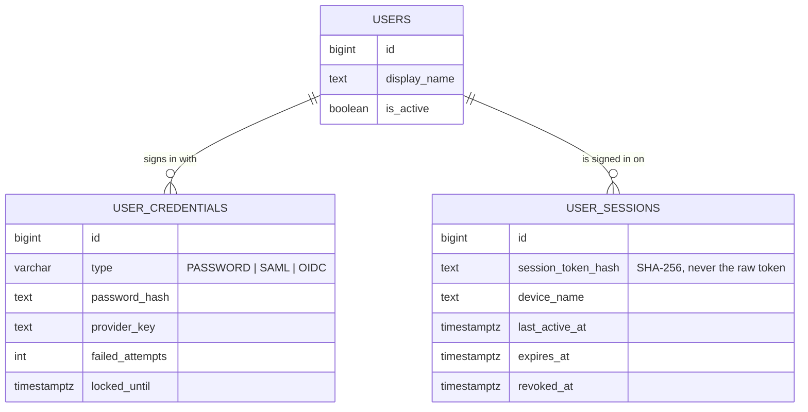
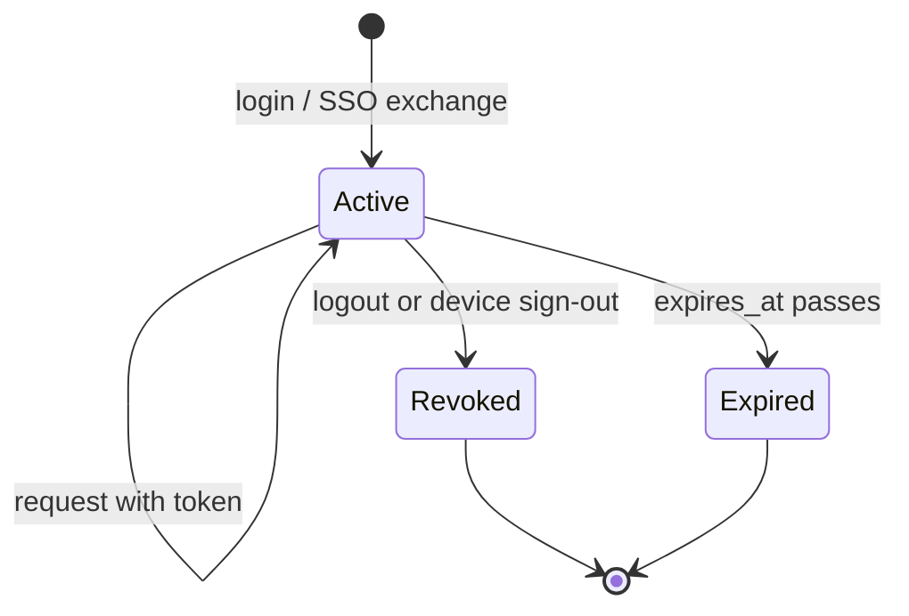
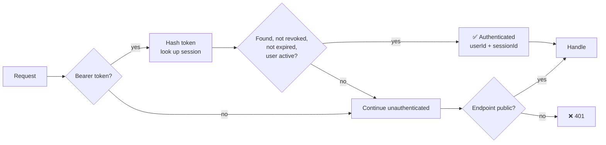
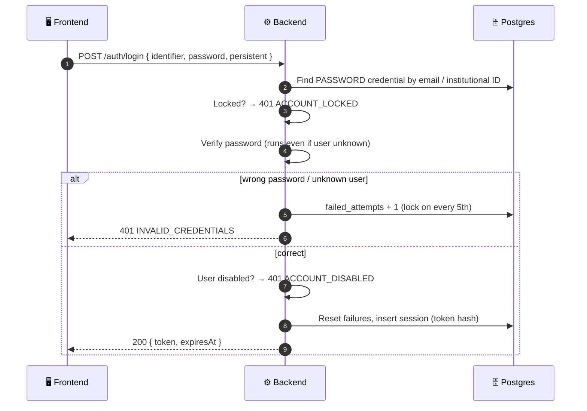
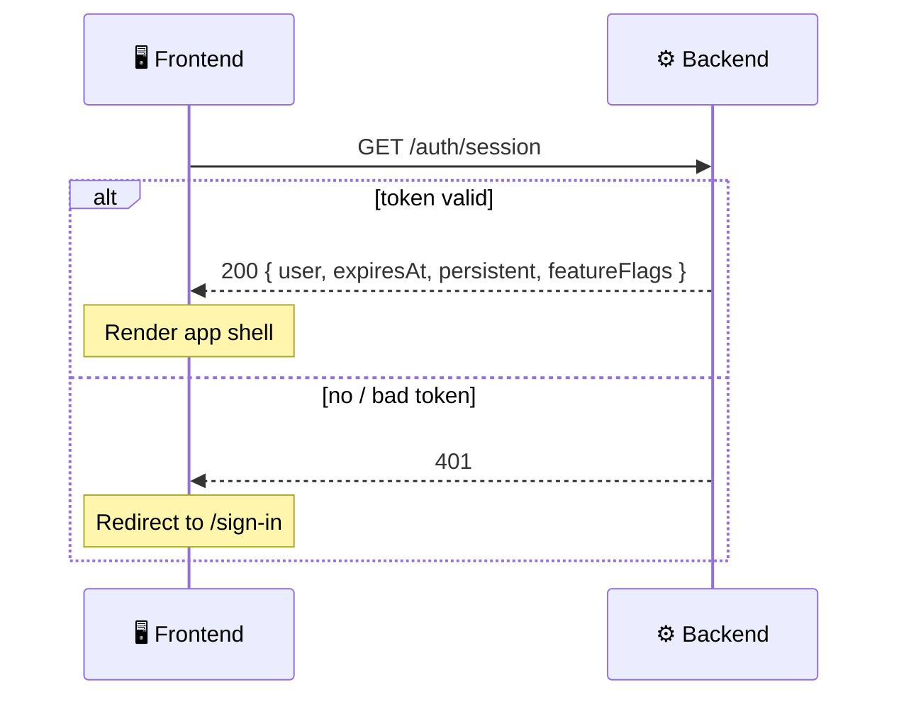
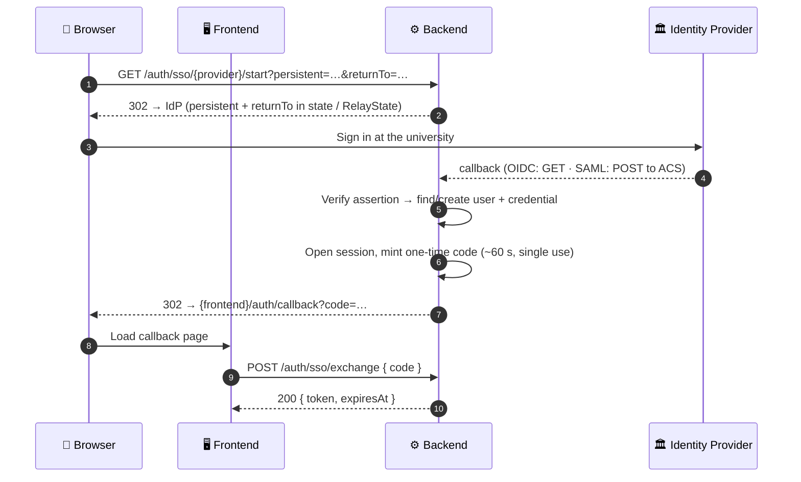

# 🔐 01. Auth & Sessions

[← API index](./README.md)

> Signing in and out, knowing who's signed in, and managing the devices they're signed in on.
> Who the user *is* (profile, settings) lives in [02. Profile & Settings](./02-profile-settings.md).

**Contents**

1. [🧠 Core concepts](#-core-concepts)
2. [🗺️ Endpoints at a glance](#️-endpoints-at-a-glance)
3. [🔑 Sign in & out](#-sign-in--out)
4. [🪪 Current session](#-current-session)
5. [💻 Devices](#-devices)
6. [🏛️ Single sign-on (SAML / OIDC)](#️-single-sign-on-saml--oidc)
7. [🤔 Open decisions](#-open-decisions)

---

## 🧠 Core concepts

| | Concept | In one line |
|---|---|---|
| 👤 | **User** | One library member. |
| 🗝️ | **Credential** | One way that user can prove who they are: `PASSWORD`, `SAML` or `OIDC`. |
| 🎫 | **Session** | One signed-in device. Created at login, ended by logout, expiry or revocation. |
| 🪙 | **Token** | Opaque random string handed to the client. Sent as `Authorization: Bearer <token>`. |



**Good to know**

- 🔒 The raw token is never stored, only its SHA-256 hash. A leaked database can't be replayed.
- ⏳ Session lifetime is **24 h**, or **30 days** with "keep me signed in" (`persistent: true`).
- 🖥️ **Kiosk mode** (shared desks) is frontend-only: it just forces `persistent: false`.
- 🏷️ Naming: `/auth/session` is always *the current one*; all of a user's sessions are exposed as **devices**.

### 🔄 Session lifecycle



### 🛡️ How every request is authenticated



---

## 🗺️ Endpoints at a glance

| Group | Method | Path | Auth | Purpose |
|---|---|---|---|---|
| 🔑 Sign in & out | `POST` | `/api/v1/auth/login` | 🌐 Public | Password login → token |
| | `POST` | `/api/v1/auth/logout` | 🔒 Bearer | End the current session |
| 🪪 Current session | `GET` | `/api/v1/auth/session` | 🔒 Bearer | Signed-in check + app-shell data |
| 💻 Devices | `GET` | `/api/v1/auth/devices` | 🔒 Bearer | Devices I'm signed in on |
| | `DELETE` | `/api/v1/auth/devices/{id}` | 🔒 Bearer | Sign one device out |
| | `DELETE` | `/api/v1/auth/devices` | 🔒 Bearer | Sign out all *other* devices |
| 🏛️ SSO | `GET` | `/api/v1/auth/providers` | 🌐 Public | Options for the login dropdown |
| | `GET` | `/api/v1/auth/sso/{provider}/start` | 🌐 Public | Redirect to the identity provider |
| | `GET` / `POST` | `/api/v1/auth/sso/{provider}/callback` | 🌐 Public | Identity provider returns here |
| | `POST` | `/api/v1/auth/sso/exchange` | 🌐 Public | One-time code → token |

---

## 🔑 Sign in & out

### `POST /api/v1/auth/login`

Password login. Returns a token for the client to send on every later request.



**Request**

```json
{ "identifier": "arpan@uni.edu", "password": "…", "persistent": false }
```

| Field | Meaning |
|---|---|
| `identifier` | Email **or** institutional ID |
| `password` | Raw password (never logged) |
| `persistent` | `true` → 30-day session · `false` → 24 h |

**Response** `200`

```json
{ "token": "…", "expiresAt": "2026-11-01T10:00:00Z" }
```

**Errors**: all `401`; branch on `code`.

| `code` | When |
|---|---|
| ❌ `INVALID_CREDENTIALS` | Unknown identifier **or** wrong password; same message for both, so neither is revealed |
| 🔒 `ACCOUNT_LOCKED` | Too many failures. Message includes the time left. |
| 🚫 `ACCOUNT_DISABLED` | `users.is_active = false` |

**🔒 Lockout ladder**: every 5 consecutive failures lock the credential, a bit longer each time:

```
 5 fails ──▶ 🔒 15 min
10 fails ──▶ 🔒 30 min
15+ fails ─▶ 🔒 24 h  (each further lock)
✅ successful login ──▶ counter reset
```

### `POST /api/v1/auth/logout`

Ends the current session (`revoked_at = now()`).

- Response `204`.
- Idempotent: logging out twice is fine.

---

## 🪪 Current session

### `GET /api/v1/auth/session`

One cheap call, two jobs:

| | Job | How |
|---|---|---|
| ✅ | **Am I signed in?** | `200` = token valid · `401` = not signed in, expired or revoked. Like OAuth2 token introspection. |
| 🧩 | **App-shell bootstrap** | The small set of data every page needs: name and avatar in the top bar, locale, feature flags. |



**Response** `200`

```json
{
  "user": {
    "displayName": "Arpan",
    "avatarImageUrl": "…",
    "language": "en",
    "timezone": "Asia/Kolkata"
  },
  "expiresAt": "2026-11-01T10:00:00Z",
  "persistent": false,
  "featureFlags": { }
}
```

| Field | Why it's here |
|---|---|
| `user` | Only what the shell displays or formats with |
| `expiresAt` | Warn before sign-out, or redirect without waiting for a `401` |
| `persistent` | Whether this is a "keep me signed in" session |
| `featureFlags` | Fine here while small and global; own endpoint only if they grow large or page-specific |

> 💡 Keep it small: it's called on every app load. The full profile and settings belong to [02. Profile & Settings](./02-profile-settings.md).

> 📝 **Note:** the current implementation returns a flat body (`displayName`, `email`, `institutionalId`, `department`, `avatarImageUrl`, `language`, `timezone`) with no session fields or flags. `email`, `institutionalId` and `department` move to [02. Profile & Settings](./02-profile-settings.md).

---

## 💻 Devices

Every signed-in device is one session. These endpoints let a user see them and sign them out, e.g. *"I left myself signed in at the library desk."*

```
💻 MacBook Pro      · Bengaluru · active now      ← this device
📱 iPhone           · Bengaluru · 2 h ago         [Sign out]
🖥️ Library Kiosk 3  · Campus    · yesterday       [Sign out]
                                     [Sign out all other devices]
```

### `GET /api/v1/auth/devices`

Active (not revoked, not expired) sessions of the current user, most recently active first. `id` is the session ID.

```json
[
  {
    "id": 42,
    "current": true,
    "deviceName": "MacBook Pro",
    "userAgent": "…",
    "ipAddress": "10.0.0.5",
    "deviceLocation": "Bengaluru, IN",
    "createdAt": "…",
    "lastActiveAt": "…",
    "expiresAt": "…"
  }
]
```

- Backed by existing `user_sessions` columns.
- No pagination; the list is small.

### `DELETE /api/v1/auth/devices/{id}`

Signs one device out (revokes its session).

- `204` on success.
- `404` if the session isn't the caller's, so other users' IDs aren't revealed.
- Signing out the current device = logout.

### `DELETE /api/v1/auth/devices`

Signs out **every device except this one**. `204`.

---

## 🏛️ Single sign-on (SAML / OIDC)

### `GET /api/v1/auth/providers`

Feeds the SAML / OIDC dropdown on the sign-in page.

```json
[
  { "key": "campus-shibboleth", "type": "SAML", "displayName": "University Shibboleth" },
  { "key": "google", "type": "OIDC", "displayName": "Google" }
]
```

### 🔁 The flow: `start` → `callback` → `exchange`



| Endpoint | What it does |
|---|---|
| `GET /sso/{provider}/start` | Redirects to the identity provider. Carries `persistent` and `returnTo` through the round-trip. |
| `GET` / `POST /sso/{provider}/callback` | Identity provider returns here (OIDC `GET`, SAML ACS `POST`). Signs the user in. |
| `POST /sso/exchange` | Swaps the one-time code for `{ token, expiresAt }`, same shape as login. `401 INVALID_CREDENTIALS` if the code is unknown, used or expired. |

**Why this shape**

- 🙈 **One-time code, not the token, in the URL:** URLs end up in browser history, logs and `Referer` headers.
- ✅ **`returnTo` is validated** against the allowed frontend origins (no open redirects).
- 🧱 **Built on Spring Security's SAML2 / OAuth2 *login* support**, not the resource-server support that bearer auth deliberately avoids.

---

## 🤔 Open decisions

| | Decision | Why it matters |
|---|---|---|
| 🆕 | **SSO first login:** create the user on the spot, or match an existing user by email? | Affects `user_credentials` unique constraints (e.g. unique `(type, provider_key)`). |
| 🏷️ | **`credential_id` on `user_sessions`** | Lets the devices list show *"Signed in with Shibboleth"*. |
| 💤 | **Idle timeout** | `last_active_at` exists but isn't updated or enforced. Should normal sessions also expire after inactivity? How often to write it (e.g. at most once a minute)? |
| 🚩 | **Feature flags** | Where they come from (config, per role, per user) and their shape in `/session`. |
