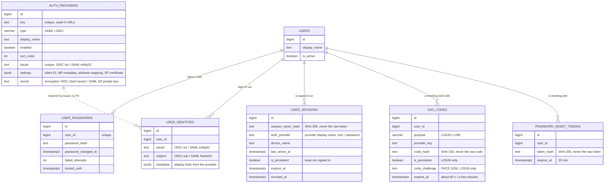
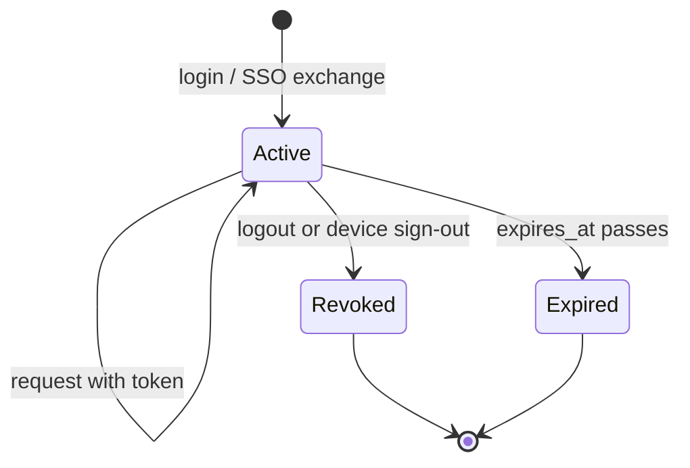
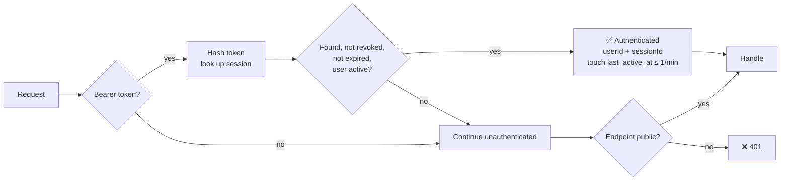
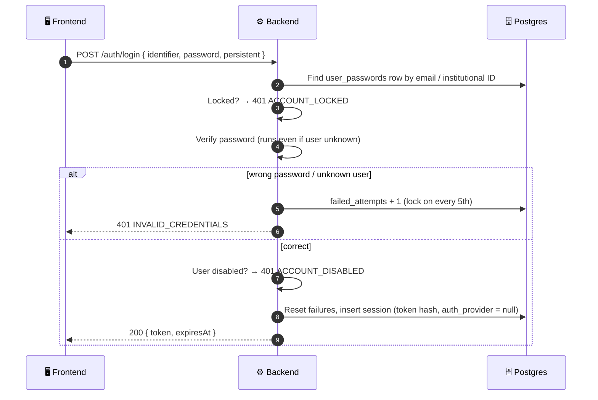
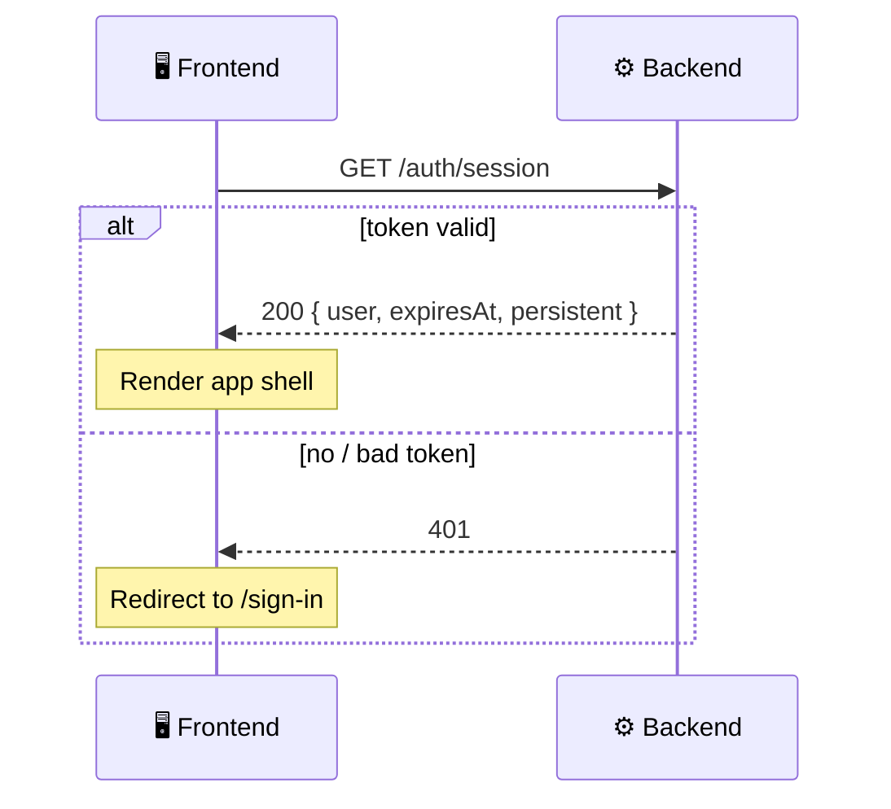
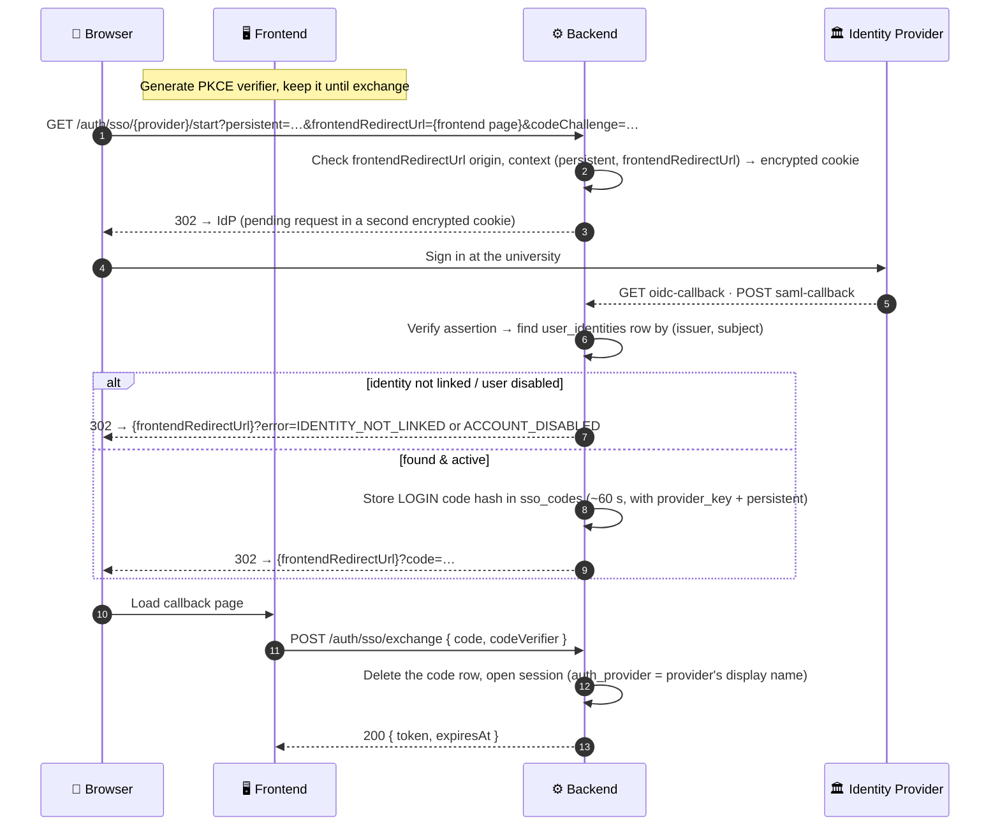
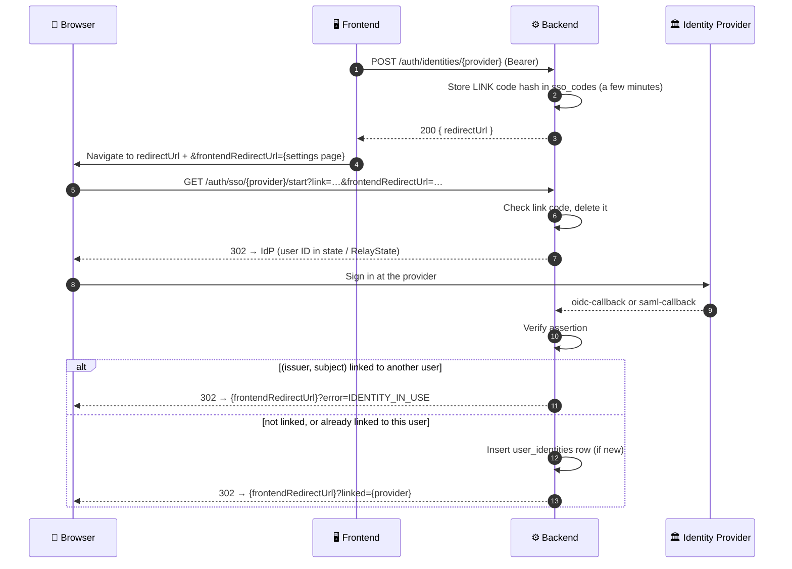
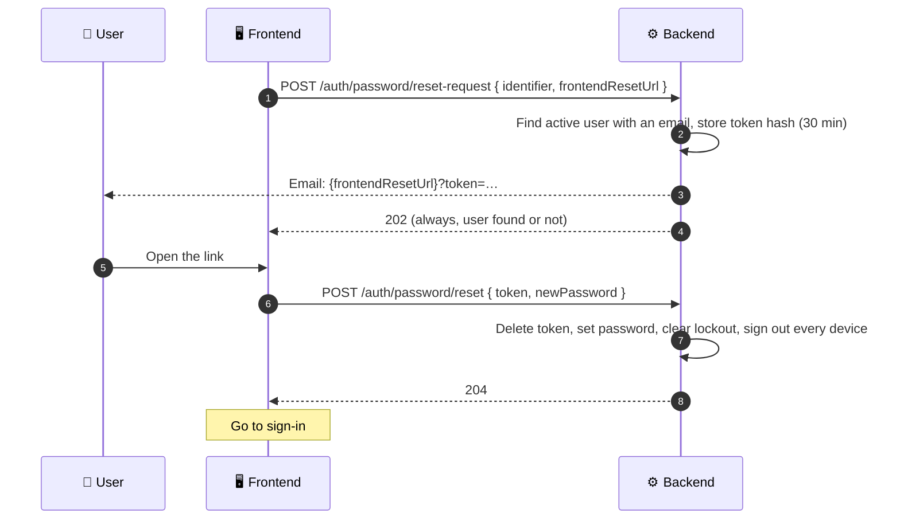

# 🔐 01. Auth & Sessions

[← API index](./README.md)

> Signing in and out, knowing who's signed in, and managing the devices they're signed in on.
> Who the user *is* (profile, settings) lives in [02. Profile & Settings](./02-profile-settings.md).

**Contents**

1. [🧠 Core concepts](#-core-concepts)
2. [🗺️ Endpoints at a glance](#️-endpoints-at-a-glance)
3. [🔑 Sign in & out](#-sign-in--out)
4. [🪪 Current session](#-current-session)
5. [💻 Devices](#-devices)
6. [🏛️ Single sign-on (SAML / OIDC)](#️-single-sign-on-saml--oidc)
7. [🔗 Sign-in methods](#-sign-in-methods)
8. [🔒 Passwords](#-passwords)
9. [🔮 Future improvements](#-future-improvements)

---

## 🧠 Core concepts

| | Concept | In one line |
|---|---|---|
| 👤 | **User** | One library member. |
| 🗝️ | **Password** | A secret we hold and verify ourselves. At most one per user. |
| 🏛️ | **Identity provider** | The university's SAML / OIDC sign-in service. Configured by library admins at runtime, not at deployment. |
| 🔗 | **Identity** | An account at an identity provider that the user linked from settings (*"Connect to Google"*). Zero or more per user. |
| 🎫 | **Session** | One signed-in device. Created at login, ended by logout, expiry or revocation. |
| 🪙 | **Token** | Opaque random string handed to the client. Sent as `Authorization: Bearer <token>`. |



**Good to know**

- 🔒 The raw token is never stored, only its SHA-256 hash. A leaked database can't be replayed.
- ⏳ Session lifetime is **24 h**, or **30 days** with "keep me signed in" (`persistent: true`, stored as `is_persistent`).
- 🖥️ **Kiosk mode** (shared desks) is frontend-only: it just forces `persistent: false`.
- 🏷️ Naming: `/auth/session` is always *the current one*; all of a user's sessions are exposed as **devices**.
- 🏛️ An SSO identity is **`(issuer, subject)`**, as OIDC and SAML define it: the provider's own ID (OIDC `iss`, SAML `entityID`) plus the user's ID there. Unique together, so two providers can never collide. The provider key used in URLs (`campus-shibboleth`) is only a label.
- 🏛️ Identity providers live in **`auth_providers`**, so library admins can add, edit or disable them without a redeploy. Identities match a provider by `issuer`, not a foreign key, so deleting and re-adding a provider keeps its users linked.
- 🔐 Each provider has one **encrypted** `secret`: the OIDC client secret, or for SAML our own private key. The encryption key comes from the deployment environment, never the database; it's the only auth secret kept outside it.
- 🗝️ Every SAML provider gets **its own key pair** (RSA 2048, self-signed certificate valid 10 years), generated the first time the provider is used. We sign requests and decrypt assertions with it; its certificate goes in `settings` and in that provider's [metadata](#get-apiv1authssoprovidermetadata). Keys rotate one IdP at a time, and deleting a provider removes its key.
- 🔒 Lockout lives on `user_passwords` only. For SSO, the identity provider handles it.
- 📝 Each session records **how** it was opened in `auth_provider`: `null` for a password, otherwise the provider's display name. A snapshot taken at sign-in, not a foreign key. Unlinking an identity or renaming a provider doesn't touch existing sessions.
- 🎟️ `sso_codes` holds short-lived, single-use codes: `LOGIN` bridges the SSO callback and `POST /sso/exchange`, `LINK` starts [connecting a provider](#-sign-in-methods). A row is deleted when it's used. The session is only opened at exchange, so `user_sessions` holds nothing but signed-in devices.
- ⏱️ `last_active_at` is **tracked, not enforced**: written at most once a minute per session, shown in the devices list. There is no idle timeout; only `expires_at` ends a session.

### 🔄 Session lifecycle



### 🛡️ How every request is authenticated



---

## 🗺️ Endpoints at a glance

| Group | Method | Path | Auth | Purpose |
|---|---|---|---|---|
| 🔑 Sign in & out | `POST` | `/api/v1/auth/login` | 🌐 Public | Password login → token |
| | `POST` | `/api/v1/auth/logout` | 🌐 Public | End the current session, if any |
| 🪪 Current session | `GET` | `/api/v1/auth/session` | 🔒 Bearer | Signed-in check + app-shell data |
| 💻 Devices | `GET` | `/api/v1/auth/devices` | 🔒 Bearer | Devices I'm signed in on |
| | `DELETE` | `/api/v1/auth/devices/{id}` | 🔒 Bearer | Sign one device out |
| | `DELETE` | `/api/v1/auth/devices` | 🔒 Bearer | Sign out all *other* devices |
| 🏛️ SSO | `GET` | `/api/v1/auth/sso/providers` | 🌐 Public | Options for the login dropdown |
| | `GET` | `/api/v1/auth/sso/{provider}/start` | 🌐 Public | Redirect to the identity provider |
| | `GET` | `/api/v1/auth/sso/{provider}/oidc-callback` | 🌐 Public | OIDC provider returns here |
| | `POST` | `/api/v1/auth/sso/{provider}/saml-callback` | 🌐 Public | SAML provider returns here (ACS) |
| | `POST` | `/api/v1/auth/sso/exchange` | 🌐 Public | One-time code → token |
| | `GET` | `/api/v1/auth/sso/{provider}/metadata` | 🌐 Public | SAML service-provider metadata for the university's IT |
| 🔗 Sign-in methods | `GET` | `/api/v1/auth/identities` | 🔒 Bearer | Providers I've connected |
| | `POST` | `/api/v1/auth/identities/{provider}` | 🔒 Bearer | Start connecting a provider |
| | `DELETE` | `/api/v1/auth/identities/{id}` | 🔒 Bearer | Disconnect a provider |
| 🔒 Passwords | `PUT` | `/api/v1/auth/password` | 🔒 Bearer | Change my password |
| | `POST` | `/api/v1/auth/password/reset-request` | 🌐 Public | Email me a link to set a new password |
| | `POST` | `/api/v1/auth/password/reset` | 🌐 Public | Set a new password with the emailed link |

---

## 🔑 Sign in & out

### `POST /api/v1/auth/login`

Password login. Returns a token for the client to send on every later request.



**Request**

```json
{ "identifier": "arpan@uni.edu", "password": "…", "persistent": false }
```

| Field | Meaning |
|---|---|
| `identifier` | Email **or** institutional ID |
| `password` | Raw password (never logged) |
| `persistent` | `true` → 30-day session · `false` → 24 h |

**Response** `200`

```json
{ "token": "…", "expiresAt": "2026-11-01T10:00:00Z" }
```

**Errors**: all `401`; branch on `code`.

| `code` | When |
|---|---|
| ❌ `INVALID_CREDENTIALS` | Unknown identifier **or** wrong password; same message for both, so neither is revealed |
| 🔒 `ACCOUNT_LOCKED` | Too many failures. Message includes the time left. |
| 🚫 `ACCOUNT_DISABLED` | `users.is_active = false` |

**🔒 Lockout ladder**: every 5 consecutive failures lock the password, a bit longer each time:

```
 5 fails ──▶ 🔒 15 min
10 fails ──▶ 🔒 30 min
15+ fails ─▶ 🔒 24 h  (each further lock)
✅ successful login ──▶ counter reset
```

### `POST /api/v1/auth/logout`

Ends the session behind the bearer token, if there is one (`revoked_at = now()`).

- Always `204`, with or without a token, and whether it's valid, expired or already revoked. Safe to call any number of times.
- Public, so a client with a stale token can still clear itself without handling a `401`.
- The frontend drops the token either way.

---

## 🪪 Current session

### `GET /api/v1/auth/session`

One cheap call, two jobs:

| | Job | How |
|---|---|---|
| ✅ | **Am I signed in?** | `200` = token valid · `401` = not signed in, expired or revoked. Like OAuth2 token introspection. |
| 🧩 | **App-shell bootstrap** | The small set of data every page needs: name and avatar in the top bar, locale. |



**Response** `200`

```json
{
  "user": {
    "displayName": "Arpan",
    "avatarImageUrl": "…",
    "language": "en",
    "timezone": "Asia/Kolkata"
  },
  "expiresAt": "2026-11-01T10:00:00Z",
  "persistent": false
}
```

| Field | Why it's here |
|---|---|
| `user` | Only what the shell displays or formats with |
| `expiresAt` | Warn before sign-out, or redirect without waiting for a `401` |
| `persistent` | Whether this is a "keep me signed in" session |

> 🔮 Feature flags aren't part of the response yet. See [Future improvements](#-future-improvements).

> 💡 Keep it small: it's called on every app load. The full profile and settings belong to [02. Profile & Settings](./02-profile-settings.md).

---

## 💻 Devices

Every signed-in device is one session. These endpoints let a user see them and sign them out, e.g. *"I left myself signed in at the library desk."*

```
💻 MacBook Pro      · Bengaluru · active now      ← this device
📱 iPhone           · Bengaluru · 2 h ago         [Sign out]
🖥️ Library Kiosk 3  · Campus    · yesterday       [Sign out]
                                     [Sign out all other devices]
```

### `GET /api/v1/auth/devices`

Active (not revoked, not expired) sessions of the current user, most recently active first. `id` is the session ID.

```json
[
  {
    "id": 42,
    "current": true,
    "deviceName": "MacBook Pro",
    "userAgent": "…",
    "ipAddress": "10.0.0.5",
    "deviceLocation": "Bengaluru, IN",
    "authProvider": "University Shibboleth",
    "createdAt": "…",
    "lastActiveAt": "…",
    "expiresAt": "…"
  }
]
```

- Backed by `user_sessions` columns.
- `authProvider` lets the UI show *"Signed in with University Shibboleth"*. It's the provider's display name at sign-in, and absent for a password sign-in.
- No pagination; the list is small.

### `DELETE /api/v1/auth/devices/{id}`

Signs one device out (revokes its session).

- `204` on success.
- `404` if the session isn't the caller's, so other users' IDs aren't revealed.
- Signing out the current device = logout.

### `DELETE /api/v1/auth/devices`

Signs out **every device except this one**. `204`.

---

## 🏛️ Single sign-on (SAML / OIDC)

### `GET /api/v1/auth/sso/providers`

Feeds the SAML / OIDC dropdown on the sign-in page: the **enabled** rows of `auth_providers`, by `sort_order`. Issuer, settings and secrets are never exposed.

```json
[
  { "key": "campus-shibboleth", "type": "SAML", "displayName": "University Shibboleth" },
  { "key": "google", "type": "OIDC", "displayName": "Google" }
]
```

### 🔁 The flow: `start` → `callback` → `exchange`



| Endpoint | What it does |
|---|---|
| `GET /sso/{provider}/start` | Redirects to the identity provider. `frontendRedirectUrl` (required) is the frontend page to come back to, e.g. `https://app.uni.edu/auth/callback`; `400` unless CORS allows its origin. Also takes `persistent`, or a `link` code when [connecting a provider](#-sign-in-methods). `404` if the provider is unknown or disabled. Signing in also requires `codeChallenge`, `BASE64URL(SHA-256(verifier))` (`400` without it). Reached by browser navigation, never `fetch`. |
| `GET /sso/{provider}/oidc-callback` · `POST /sso/{provider}/saml-callback` | Identity provider returns here: one path per protocol, so each is handled by its own Spring Security filter. Signs the user in, or redirects with `error` (see below). An unknown provider, or one of the other protocol, counts as a failed sign-in. |
| `POST /sso/exchange` | Body `{ code, codeVerifier }`. Swaps the one-time code for `{ token, expiresAt }`, same shape as login. Deletes the code (even if the exchange fails) and opens the session. `401 INVALID_CREDENTIALS` if the code is unknown, used or expired, or the verifier doesn't match. |

**Callback errors** (sent as `?error=` on `frontendRedirectUrl`; nothing in the URL reveals the user)

| `error` | When |
|---|---|
| 🚪 `IDENTITY_NOT_LINKED` | No identity matches `(issuer, subject)`. The user must sign in another way and [connect the provider](#-sign-in-methods) first. SSO never creates users. |
| 🚫 `ACCOUNT_DISABLED` | Identity found, but `users.is_active = false` |
| ⚠️ `SSO_FAILED` | The round-trip itself failed: cancelled at the provider, or an invalid response |

If the round-trip state is gone (it took over 10 minutes, or the callback wasn't reached from `start`), there's no trusted page to send the browser to, so the callback answers `400` problem+json itself.

### `GET /api/v1/auth/sso/{provider}/metadata`

SAML only. Returns OpenShelves' **service-provider metadata** (XML): entity ID, ACS URL (`/sso/{provider}/saml-callback`) and **this provider's** certificate, used for both signing and encryption. The university's IT imports it into their IdP to register OpenShelves.

- `404` for an unknown, disabled or OIDC provider.
- Served by Spring Security's SAML2 metadata filter, mapped to this path.

**Why this shape**

- 🚪 **No JIT creation:** SSO only signs in users who already [connected that provider](#-sign-in-methods) from settings. No matching by email, so an identity provider can't claim an existing account just by asserting its email.
- 🙈 **One-time code, not the token, in the URL:** URLs end up in browser history, logs and `Referer` headers.
- 🔏 **PKCE on our own exchange** (S256, RFC 7636): the client keeps a random verifier, sends only its hash at `start`, and must present the verifier to exchange the code. A code intercepted on the way back (e.g. by another app claiming a mobile URL scheme) is useless on its own. Mobile apps should return through universal / App Links on a CORS-allowed domain and use the system browser.
- ✅ **`frontendRedirectUrl` is a full frontend URL**, so several web frontends on different origins can share one API; each picks its own callback page (and keeps its own "open after sign-in" path in it, e.g. `?next=/books/42`). Its origin must be **allowed by the API's CORS rules**: a frontend that may call the API may also receive its sign-ins. So CORS must list only our own frontends; a broad pattern would let any matching site receive one-time codes.
- 🍪 **No server session:** the round-trip state lives in two short-lived, encrypted, `HttpOnly` cookies scoped to `/api/v1/auth/sso` (`SameSite=Lax` for OIDC, `None` for SAML, which posts back from the provider's site). The frontend never touches them.
- 🧱 **Built on Spring Security's SAML2 / OAuth2 *login* support**, not the resource-server support that bearer auth deliberately avoids.

---

## 🔗 Sign-in methods

A signed-in user can connect an identity provider from settings (*"Connect to Google"*), and sign in with it from then on. This is the only way an identity gets linked.

```
🔑 Password                                    [Change]
🏛️ University Shibboleth · arpan@uni.edu       [Disconnect]
🟢 Google                                      [Connect]
```

The available providers come from [`GET /auth/sso/providers`](#get-apiv1authssoproviders); the connected ones from `GET /auth/identities`.

### `GET /api/v1/auth/identities`

Identities linked to the current user.

```json
[
  {
    "id": 7,
    "providerKey": "campus-shibboleth",
    "providerName": "University Shibboleth",
    "linkedAs": "arpan@uni.edu",
    "createdAt": "…",
    "lastUsedAt": "…"
  }
]
```

- `providerKey` / `providerName` come from the `auth_providers` row with the same `issuer`; both are absent if that provider no longer exists.
- `linkedAs` is a display hint from `metadata` (email or name the provider sent), absent if it sent none.

### 🔁 Connecting a provider

The bearer token lives in a header, which a browser redirect can't carry. So the frontend first asks for a short-lived **link code** with its token, then sends the browser through the normal SSO `start` with that code.



### `POST /api/v1/auth/identities/{provider}`

Starts connecting a provider. Response `200`:

```json
{ "redirectUrl": "https://api.…/api/v1/auth/sso/google/start?link=…" }
```

- `404` if the provider is unknown or disabled.
- The link code is single use and expires within minutes. Only its hash is stored.
- The frontend adds `&frontendRedirectUrl=` (its settings page) before navigating; it's checked like any `start`.
- No session is opened by this flow; the user stays signed in as before.

**Callback results** (on `frontendRedirectUrl`)

| Query | When |
|---|---|
| ✅ `linked={provider}` | Identity linked, or was already linked to this user |
| 🚫 `error=IDENTITY_IN_USE` | That `(issuer, subject)` is already linked to a different user |
| ⌛ `error=LINK_EXPIRED` | Link code unknown, used or expired |

### `DELETE /api/v1/auth/identities/{id}`

Disconnects a provider. `204`.

- `404` if the identity isn't the caller's.
- `409 LAST_SIGN_IN_METHOD` if it's the user's only way to sign in (no password, no other identity).
- Existing sessions opened with it stay signed in; sign them out from [Devices](#-devices) if needed.

---

## 🔒 Passwords

Changing a password while signed in, and setting one through an emailed link. The emailed link covers both **forgot password** and **first-time setup**: there's no sign-up, so a provisioned user (or one who has only used SSO) gets their first password this way.

**Rules for a new password**

- 12 to 128 characters, any characters. No composition rules (digits, symbols), following current NIST guidance.
- When changing, it can't be the same as the current one.

### `PUT /api/v1/auth/password`

Changes the signed-in user's password. `204`.

```json
{ "currentPassword": "…", "newPassword": "…" }
```

- Signs out **every other device**; this one stays signed in.
- A wrong `currentPassword` counts towards the [lockout](#post-apiv1authlogin), like a failed login.
- Users without a password (SSO only) set one through the emailed link instead.

| Status · `code` | When |
|---|---|
| `400` (validation) | `newPassword` isn't 12–128 characters |
| `400 INVALID_CURRENT_PASSWORD` | `currentPassword` is wrong, or the user has no password |
| `400 PASSWORD_UNCHANGED` | `newPassword` is the same as the current one |
| `401 ACCOUNT_LOCKED` | Too many wrong attempts |

### 🔁 Setting a password by email



### `POST /api/v1/auth/password/reset-request`

```json
{ "identifier": "arpan@uni.edu", "frontendResetUrl": "https://app.uni.edu/reset-password" }
```

- Always `202`, whether or not the user exists, has an email, or is disabled, so it can't be used to find accounts.
- `frontendResetUrl` is the frontend page the emailed link opens; `400` unless CORS allows its origin, as for SSO.
- A new request replaces any earlier link for that user. Requests within a minute of the last one are ignored, so the endpoint can't be used to flood an inbox.
- Works for users without a password too: setting one creates it.

### `POST /api/v1/auth/password/reset`

```json
{ "token": "…", "newPassword": "…" }
```

Sets the password and returns `204`. The user then signs in normally.

- The link is single use and expires after **30 minutes**. Only its hash is stored, and it's used up by any attempt, even a failed one.
- Clears any lockout, and signs out **every device**.

| Status · `code` | When |
|---|---|
| `400` (validation) | `newPassword` isn't 12–128 characters |
| `400 RESET_LINK_EXPIRED` | The token is unknown, used or expired |
| `401 ACCOUNT_DISABLED` | The user was disabled since the link was sent |

> 📧 **Email delivery:** sent through the app's email sender. For now that only logs the message, so in development the link is in the server log.

> 🔐 **Whoever controls the email controls the account**, including SSO-only accounts, which this flow can give a password. That's acceptable because emails are university-issued; it's also why the flow never reveals whether an account exists.

---

## 🔮 Future improvements

| | Idea | Notes |
|---|---|---|
| 🚩 | **Feature flags in `GET /auth/session`** | A `featureFlags` object in the response once the first real flag exists. To settle then: source (global config, per role, per user) and shape. Fine in `/session` while small and global; own endpoint if they grow large or page-specific. |
| 💤 | **Idle timeout** | `last_active_at` is already tracked, so an idle rule (e.g. for kiosk / non-persistent sessions) can be added later without a schema change. |
| 🚪 | **SSO single logout** | Signing out at the identity provider too. Sessions would then need the provider's `issuer`, since `auth_provider` is only a display name. |
| 🧹 | **Session cleanup** | Revoked and expired `user_sessions` rows, and expired `sso_codes`, are never removed. A periodic purge (e.g. daily, keeping a short audit window) keeps the tables small. |
| 🚦 | **Login rate limit per IP** | Lockout is per account, so one password tried against many accounts isn't slowed down. A per-IP limit on `POST /auth/login` covers that. |
