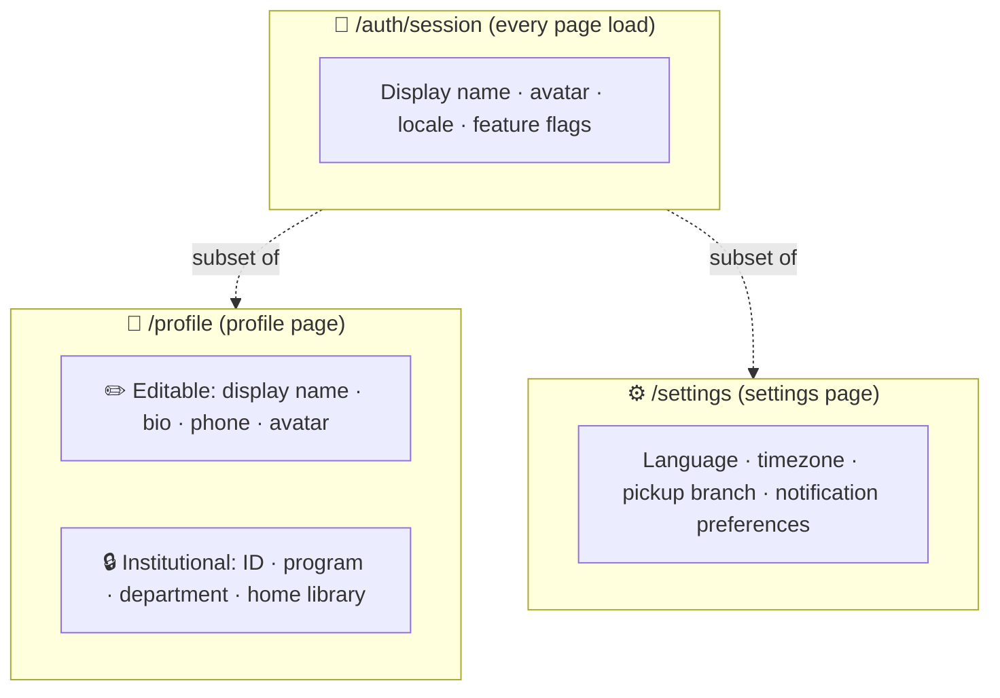

# 👤 02. Profile & Settings

[← API index](./README.md)

> The signed-in user's own data.
> **Profile** is who you are. **Settings** is how the app behaves for you.

**Contents**

1. [🧠 Core concepts](#-core-concepts)
2. [🗺️ Endpoints at a glance](#️-endpoints-at-a-glance)
3. [🪪 Profile](#-profile)
4. [⚙️ Settings](#️-settings)
5. [🤔 Open decisions](#-open-decisions)

---

## 🧠 Core concepts

Three different things describe "me". Each has one home:



| | Who owns it | Who can change it |
|---|---|---|
| ✏️ Personal profile fields | The user | The user |
| 🔒 Institutional fields | The university (SIS / IdP sync) | Nobody through this API |
| ⚙️ Settings | The user | The user |

**Owned elsewhere** (the Settings page links to them):

- 💻 **Signed-in devices:** [01. Auth & Sessions](./01-auth-sessions.md#-devices)
- 🚦 **Account standing, borrow limit:** [04. Circulation](./04-circulation.md#-borrowing-status)

---

## 🗺️ Endpoints at a glance

| Group | Method | Path | Purpose |
|---|---|---|---|
| 🪪 Profile | `GET` | `/api/v1/profile` | My full profile |
| | `PATCH` | `/api/v1/profile` | Edit my personal fields |
| | `PUT` | `/api/v1/profile/avatar` | Upload / replace my avatar |
| | `DELETE` | `/api/v1/profile/avatar` | Remove my avatar |
| ⚙️ Settings | `GET` | `/api/v1/settings` | My settings |
| | `PATCH` | `/api/v1/settings` | Change some settings |

---

## 🪪 Profile

### `GET /api/v1/profile`

```json
{
  "id": 7,
  "displayName": "Arpan Mahanty",
  "email": "arpan@uni.edu",
  "phone": "+91 98xxxxxx10",
  "bio": "PhD candidate, ecological systems.",
  "avatarImageUrl": "…",
  "institutional": {
    "institutionalId": "S1234567",
    "cardNumber": "2900 1234 5678",
    "accountType": "STUDENT",
    "program": "PhD Ecology",
    "department": "Environmental Sciences",
    "homeBranch": { "id": 1, "name": "Central University Library" }
  }
}
```

- `institutional` is read-only and grouped so the UI can show it as one locked block.

> 📝 **Note:** `cardNumber`, `accountType` and `homeBranch` have no columns in `users` yet.

### `PATCH /api/v1/profile`

Send only what changes.

```json
{ "displayName": "Arpan M.", "bio": "…", "phone": "…" }
```

- `200` with the updated profile.
- `400 VALIDATION_FAILED` for bad values.
- Any `institutional` or `email` field → `400 FIELD_NOT_EDITABLE`.

### `PUT /api/v1/profile/avatar`

`multipart/form-data` with one `file` part (PNG / JPEG / WebP, ≤ 2 MB).

- `200 { "avatarImageUrl": "…" }`
- `400 UNSUPPORTED_MEDIA` / `400 FILE_TOO_LARGE`

### `DELETE /api/v1/profile/avatar`

`204`. The UI falls back to initials.

---

## ⚙️ Settings

### `GET /api/v1/settings`

```json
{
  "language": "en",
  "timezone": "Asia/Kolkata",
  "defaultPickupBranchId": 1,
  "notifications": {
    "channels": { "inApp": true, "email": true },
    "events": {
      "HOLD_READY": true,
      "LOAN_DUE_SOON": true,
      "OVERDUE": true,
      "FEE_ASSESSED": true,
      "NEW_ARRIVAL": false
    }
  }
}
```

| Setting | Used by |
|---|---|
| 🌍 `language`, `timezone` | Formatting everywhere; also returned by `/auth/session` |
| 📍 `defaultPickupBranchId` | Pre-selected when placing a hold ([04](./04-circulation.md)) |
| 🔔 `notifications` | Which events create notifications, and where they're delivered ([09](./09-notifications.md)) |

### `PATCH /api/v1/settings`

Partial update; nested objects merge.

```json
{ "notifications": { "events": { "NEW_ARRIVAL": true } } }
```

- `200` with the full settings.
- `400 VALIDATION_FAILED` for an unknown language, timezone, branch or event.

> 📝 **Note:** `language` and `timezone` already exist on `users`. Pickup branch and notification preferences need storage.

---

## 🤔 Open decisions

| | Decision | Why it matters |
|---|---|---|
| 🏫 | **Where institutional fields come from:** SSO attributes at sign-in, a nightly SIS sync, or manual staff entry? | Decides whether they ever change, and who fixes them when wrong. |
| 🖼️ | **Avatar storage:** database, local disk, or object storage (S3)? | `avatarImageUrl` must stay valid and cheap to serve. |
| 🗄️ | **Settings storage:** columns on `users`, or a `user_settings` table / JSONB? | New settings get added often; JSONB avoids a migration each time. |
| ✉️ | **Email change:** allowed at all? It's also a sign-in identifier. | Would need verification and must not break SSO matching. |
