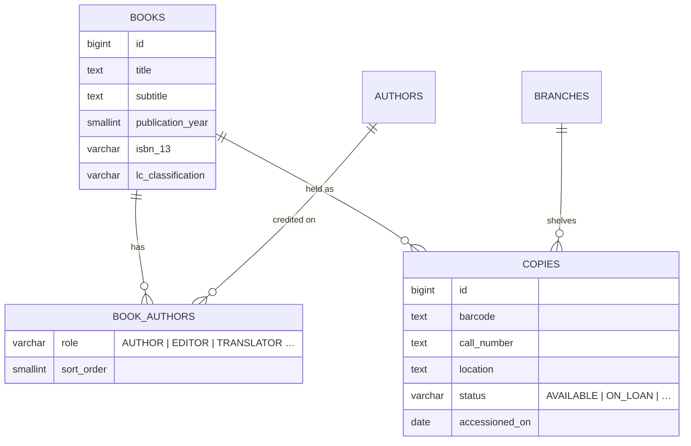
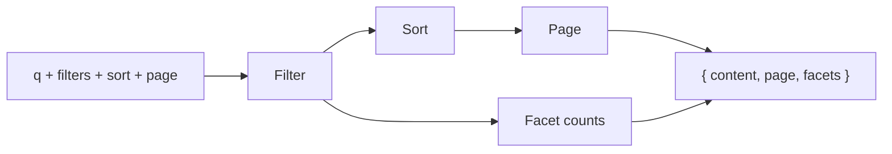

# 🔎 03. Catalog & Discovery

[← API index](./README.md)

> Finding books and reading about them: search with facets, the book detail page, new arrivals and recommendations.
> Read-only for patrons. Adding and editing records is [12. Admin: Cataloging](./12-admin-cataloging.md).

**Contents**

1. [🧠 Core concepts](#-core-concepts)
2. [🗺️ Endpoints at a glance](#️-endpoints-at-a-glance)
3. [🔍 Search & browse](#-search--browse)
4. [📖 Book detail](#-book-detail)
5. [✨ Discovery feeds](#-discovery-feeds)
6. [🤔 Open decisions](#-open-decisions)

---

## 🧠 Core concepts

| | Concept | In one line |
|---|---|---|
| 📕 | **Book** | One bibliographic record (a work in a given edition). What you search for. |
| ✍️ | **Contributor** | A person linked to a book with a role: author, editor, translator… |
| 📦 | **Copy** | One physical item on a shelf, with a barcode and a branch. A book has 0..n copies. |
| 🚦 | **Availability** | Summary of a book's copies and online access, computed for cards and filters. |



> 📝 **Note:** `books`, `authors` and `book_authors` exist. `copies` and `branches` are new.

### 🚦 Availability

Every book card and the detail page carry the same small summary:

```json
{
  "availability": {
    "status": "AVAILABLE",
    "availableCopies": 2,
    "totalCopies": 3,
    "holdQueueLength": 0,
    "onlineAccess": false
  }
}
```

| `status` | Meaning |
|---|---|
| 🟢 `AVAILABLE` | At least one copy on the shelf |
| 🌐 `ONLINE` | Full text online (licensed) |
| 🔓 `OPEN_ACCESS` | Full text online, free |
| 🔴 `CHECKED_OUT` | All copies on loan |
| 📌 `RESERVE` | Course reserve, short loan |
| 🔒 `RESTRICTED` | Non-circulating (rare books room) |
| 🚚 `IN_TRANSIT` | Moving between branches |
| 🛒 `ON_ORDER` | Ordered, not yet received |

---

## 🗺️ Endpoints at a glance

| Group | Method | Path | Purpose |
|---|---|---|---|
| 🔍 Search & browse | `GET` | `/api/v1/books` | Search / filter / sort, with facet counts |
| 📖 Book detail | `GET` | `/api/v1/books/{id}` | Full record |
| | `GET` | `/api/v1/books/{id}/copies` | Physical copies and where they are |
| | `GET` | `/api/v1/books/{id}/related` | "More like this" carousel |
| ✨ Discovery | `GET` | `/api/v1/books/recommended` | Personal recommendations |
| | `GET` | `/api/v1/catalog/stats` | Headline numbers for discovery pages |

New arrivals and the Home highlights are **the search endpoint with a filter**, not separate endpoints.

---

## 🔍 Search & browse

### `GET /api/v1/books`

One endpoint powers the catalog page, the top-bar search and new arrivals.



**Query parameters** (all optional; repeat a parameter for OR within a group)

| Param | Example | Meaning |
|---|---|---|
| `q` | `ecosystem resilience` | Free text over title, subtitle, contributors, subjects, publisher, ISBN, DOI, call number |
| `access` | `SHELF`, `ONLINE`, `OPEN_ACCESS`, `ILL` | How you can get it |
| `type` | `PRINT`, `EBOOK`, `JOURNAL`, `THESIS`, `ARCHIVAL` | Resource type group |
| `subject` | `ecology` | Subject facet key |
| `language` | `en` | ISO language |
| `yearFrom`, `yearTo` | `2010`, `2024` | Publication year range |
| `accessionedAfter` | `2026-10-01` | New arrivals: first copy received on or after |
| `sort` | `publicationYear,desc` | `relevance` (default with `q`), `publicationYear`, `title`, `author`, `accessionedOn`, `callNumber` |
| `page`, `size` | `0`, `24` | Paging |

**Response** `200`

```json
{
  "content": [
    {
      "id": 101,
      "title": "Ecosystem Resilience in a Changing World",
      "subtitle": "Thresholds, Feedbacks and Recovery",
      "contributors": [{ "name": "Marion Vance", "role": "AUTHOR" }],
      "publisher": "Oxford University Press",
      "publicationYear": 2023,
      "resourceType": "MONOGRAPH",
      "callNumber": "QH541 .V36 2023",
      "coverImageUrl": "…",
      "subjects": ["Ecology", "Climate Adaptation"],
      "peerReviewed": true,
      "availability": { "status": "AVAILABLE", "availableCopies": 2, "totalCopies": 3, "holdQueueLength": 0, "onlineAccess": false }
    }
  ],
  "page": { "size": 24, "number": 0, "totalElements": 312, "totalPages": 13 },
  "facets": {
    "access":   [{ "key": "SHELF", "count": 140 }, { "key": "ONLINE", "count": 96 }],
    "type":     [{ "key": "PRINT", "count": 180 }],
    "subject":  [{ "key": "ecology", "label": "Ecology", "count": 75 }],
    "language": [{ "key": "en", "count": 290 }],
    "year":     { "min": 1962, "max": 2026 }
  }
}
```

- **Facet counts** are computed on the result *before* that facet's own filter, so ticking "Ecology" doesn't hide the other subjects.
- The list item is a **summary**. Full record → detail endpoint.

**🆕 New arrivals page** = this endpoint:

```
GET /api/v1/books?accessionedAfter=2026-10-02&sort=accessionedOn,desc
```

| Demo period chip | `accessionedAfter` |
|---|---|
| This week | today − 7 days |
| This month | today − 30 days |
| Past 90 days | today − 90 days |

**🏠 Home highlights** = the same, `size=5`.

---

## 📖 Book detail

### `GET /api/v1/books/{id}`

Everything the resource-detail page shows, in one call.

```json
{
  "id": 101,
  "title": "Ecosystem Resilience in a Changing World",
  "subtitle": "Thresholds, Feedbacks and Recovery",
  "edition": "3rd Revised Edition",
  "contributors": [
    { "authorId": 55, "name": "Marion Vance", "role": "AUTHOR", "affiliation": "Univ. of Edinburgh" }
  ],
  "publisher": "Oxford University Press",
  "publicationYear": 2023,
  "language": "en",
  "pageCount": 412,
  "series": { "name": "Oxford Ecology Series", "number": 14 },
  "identifiers": { "isbn13": "9780198834922", "isbn10": "0198834926", "doi": "10.1093/oso/…", "olid": "OL123M" },
  "classification": { "lcc": "QH541 .V36 2023", "dewey": "577.18" },
  "subjects": ["Ecology", "Climate Adaptation"],
  "abstract": "…",
  "tableOfContents": [
    { "title": "Part I: Foundations", "pages": "1–98", "chapters": [{ "title": "Stability & Equilibrium", "page": "3" }] }
  ],
  "coverImageUrl": "…",
  "peerReviewed": true,
  "fullTextUrl": null,
  "availability": { "status": "AVAILABLE", "availableCopies": 2, "totalCopies": 3, "holdQueueLength": 0, "onlineAccess": false }
}
```

- `404` if the book doesn't exist.
- Whether *I* have it on loan / on hold comes from [04. Circulation](./04-circulation.md); the book record is the same for everyone.

### `GET /api/v1/books/{id}/copies`

The "Holdings" tab. Plain array.

```json
[
  {
    "id": 9001,
    "barcode": "31234009876543",
    "branch": { "id": 1, "name": "Central Library" },
    "location": "3rd Floor, Section East, Shelf 148",
    "callNumber": "QH541 .V36 2023 c.1",
    "status": "ON_LOAN",
    "dueOn": "2026-11-27",
    "note": null
  }
]
```

`status`: `AVAILABLE` · `ON_LOAN` · `RESERVE` · `IN_TRANSIT` · `NON_CIRCULATING`

### `GET /api/v1/books/{id}/related?limit=8`

Plain array of book summaries (same shape as search results). Based on shared subjects and contributors to start with.

---

## ✨ Discovery feeds

### `GET /api/v1/books/recommended?size=12`

Personal: ranked by overlap with my history, lists and saved subjects. Paged book summaries, plus a `score` (0–100) per item for the affinity badge.

```json
{
  "content": [{ "id": 101, "title": "…", "availability": { "…": "…" }, "score": 92 }],
  "page": { "size": 12, "number": 0, "totalElements": 40, "totalPages": 4 }
}
```

### `GET /api/v1/catalog/stats`

Headline numbers for the discovery pages.

```json
{ "totalBooks": 18432, "totalCopies": 24510, "newArrivalsLast30Days": 128 }
```

Counts for a specific filter (e.g. "312 catalog matches") come from `page.totalElements`, not here.

---

## 🤔 Open decisions

| | Decision | Why it matters |
|---|---|---|
| 🔍 | **Search engine:** Postgres full-text (`tsvector` + GIN) first, or OpenSearch from the start? | Relevance, facets and typo tolerance. Postgres is enough to start. |
| 🏷️ | **Subjects:** free-text strings on the book, or a `subjects` table with stable keys? | Facets need stable keys and labels. |
| 🧾 | **Book vs edition:** one row per edition (today), or work → editions? | Affects "other editions", related books and holds ("any edition"). |
| 🤖 | **Recommendations:** simple subject overlap, or a precomputed table refreshed nightly? | Cost per request vs freshness. |
| ✍️ | **Author pages:** `GET /api/v1/authors/{id}`? | Not in the demo; contributors carry `authorId` so it can be added later. |
