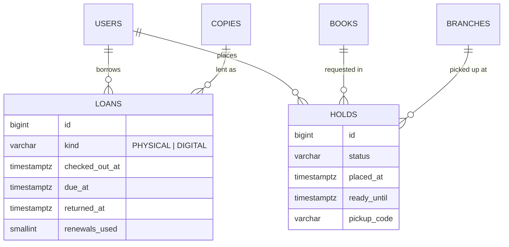
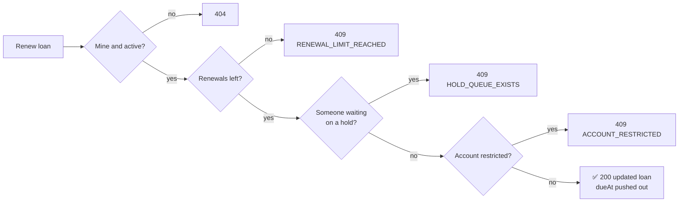
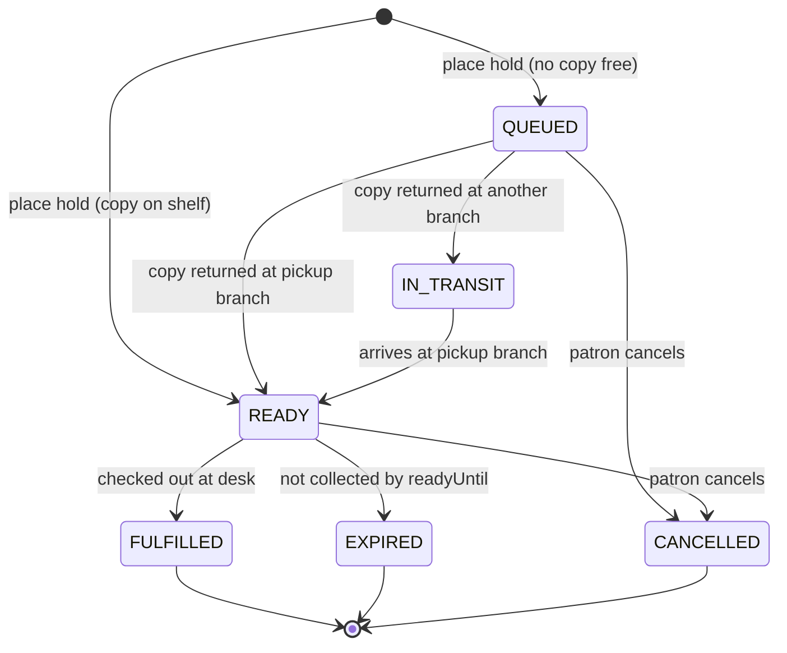

# 🔄 04. Circulation

[← API index](./README.md)

> What I have borrowed, what I'm waiting for, and whether I'm allowed to borrow more.
> Patron side only. Checkout and return at the desk are staff workflows, added later.

**Contents**

1. [🧠 Core concepts](#-core-concepts)
2. [🗺️ Endpoints at a glance](#️-endpoints-at-a-glance)
3. [📚 Loans](#-loans)
4. [⏳ Holds](#-holds)
5. [🚦 Borrowing status](#-borrowing-status)
6. [🏢 Branches](#-branches)
7. [🤔 Open decisions](#-open-decisions)

---

## 🧠 Core concepts

| | Concept | In one line |
|---|---|---|
| 📚 | **Loan** | A copy I've borrowed, with a due date. Physical or digital. |
| 🔁 | **Renewal** | Pushing a loan's due date out. Limited per loan. |
| ⏳ | **Hold** | A place in the queue for a book. Becomes **ready** when a copy is set aside for me. |
| 🚦 | **Borrowing status** | Am I allowed to borrow, and how close am I to my limits? |



- A **hold is on a book**, not a copy: the first copy that comes back fills it.
- A **returned loan** (`returned_at` set) becomes a [reading history](./08-reading-history.md) entry.

---

## 🗺️ Endpoints at a glance

| Group | Method | Path | Purpose |
|---|---|---|---|
| 📚 Loans | `GET` | `/api/v1/loans` | My current loans |
| | `POST` | `/api/v1/loans/{id}/renew` | Renew one loan |
| | `POST` | `/api/v1/loans/renew-all` | Renew everything eligible |
| ⏳ Holds | `GET` | `/api/v1/holds` | My holds |
| | `POST` | `/api/v1/holds` | Place a hold |
| | `DELETE` | `/api/v1/holds/{id}` | Cancel a hold |
| 🚦 Status | `GET` | `/api/v1/borrowing-status` | Standing and limits |
| 🏢 Branches | `GET` | `/api/v1/branches` | Library branches (pickup locations) |

---

## 📚 Loans

### `GET /api/v1/loans`

My **active** loans (not returned), soonest due first. Plain array; bounded by the borrow limit.

```json
[
  {
    "id": 3001,
    "kind": "PHYSICAL",
    "book": { "id": 101, "title": "Ecosystem Resilience in a Changing World", "contributors": [{ "name": "Marion Vance", "role": "AUTHOR" }], "coverImageUrl": "…" },
    "copy": { "barcode": "31234009876543", "callNumber": "QH541 .V36 2023 c.1", "branch": { "id": 1, "name": "Central Library" } },
    "checkedOutAt": "2026-09-27T10:12:00Z",
    "dueAt": "2026-10-27T18:30:00Z",
    "overdue": false,
    "renewals": { "used": 1, "max": 3 },
    "renewable": true,
    "notRenewableReason": null
  }
]
```

- `renewable` + `notRenewableReason` let the UI grey out the button with the right message, without guessing the rules.
- Digital loans have `copy: null` and a `licenseNote`, e.g. "Institutional licence".

### `POST /api/v1/loans/{id}/renew`



- `200` → the updated loan (new `dueAt`, `renewals.used + 1`).
- Errors are `409`; branch on `code` as shown.

### `POST /api/v1/loans/renew-all`

Tries every active loan; never fails as a whole.

```json
{
  "renewed": [ { "…loan…": "…" } ],
  "skipped": [ { "loanId": 3002, "code": "HOLD_QUEUE_EXISTS" } ]
}
```

UI toast: *"Renewed 3 of 4. 1 has a waiting list."*

---

## ⏳ Holds

### 🔄 Hold lifecycle



### `GET /api/v1/holds`

My open holds (`QUEUED`, `IN_TRANSIT`, `READY`); ready ones first. Plain array.

```json
[
  {
    "id": 4001,
    "status": "READY",
    "book": { "id": 102, "title": "…", "coverImageUrl": "…" },
    "placedAt": "2026-10-20T09:00:00Z",
    "queue": { "position": 1, "length": 1 },
    "pickupBranch": { "id": 1, "name": "Central Library", "detail": "Main Floor, West Wing" },
    "readyUntil": "2026-11-05T18:30:00Z",
    "pickupCode": "H-4KQ7"
  }
]
```

- `readyUntil` and `pickupCode` are only set when `READY`.

### `POST /api/v1/holds`

```json
{ "bookId": 102, "pickupBranchId": 1 }
```

- `pickupBranchId` defaults to my settings' default pickup branch.
- `201` → the new hold.

| `409` code | When |
|---|---|
| `HOLD_EXISTS` | I already have an open hold on this book |
| `ALREADY_ON_LOAN` | I already have a copy |
| `NOT_HOLDABLE` | Restricted / non-circulating / online-only |
| `ACCOUNT_RESTRICTED` | See [borrowing status](#-borrowing-status) |
| `HOLD_LIMIT_REACHED` | Too many open holds |

### `DELETE /api/v1/holds/{id}`

`204`. `404` if not mine or already closed.

---

## 🚦 Borrowing status

### `GET /api/v1/borrowing-status`

One place for "can I borrow?" so the UI never recomputes the rules.

```json
{
  "standing": "GOOD",
  "restrictions": [],
  "loans": { "active": 4, "limit": 25 },
  "holds": { "active": 2, "limit": 10 },
  "overdueCount": 0
}
```

| `standing` | Meaning |
|---|---|
| ✅ `GOOD` | Can borrow and place holds |
| ⛔ `RESTRICTED` | Blocked; `restrictions` says why, e.g. `[{ "code": "FINES_OVER_THRESHOLD" }]` |

Fines feed into this ([07](./07-fines-payments.md)), but the rule lives here.

---

## 🏢 Branches

### `GET /api/v1/branches`

Reference data for pickup choices, copy locations and the home library. Plain array.

```json
[
  { "id": 1, "name": "Central Library", "address": "…", "pickupPoint": true },
  { "id": 2, "name": "Science Library", "address": "…", "pickupPoint": true }
]
```

---

## 🤔 Open decisions

| | Decision | Why it matters |
|---|---|---|
| 📏 | **Loan policy:** fixed per patron type, or per item type too (reserve = 4 h, standard = 30 days)? | Drives due dates, renewal length and limits. Needs a `loan_policies` table either way. |
| 🔁 | **Renewal length:** from today, or from the old due date? | The demo extends from the due date (+31 days). |
| 🌐 | **Digital loans:** do we manage licences, or just link out? | If link-out only, digital loans may not need to exist at all. |
| ⏰ | **Who expires ready holds and marks overdue loans?** A scheduled job? | Also triggers notifications ([09](./09-notifications.md)). |
