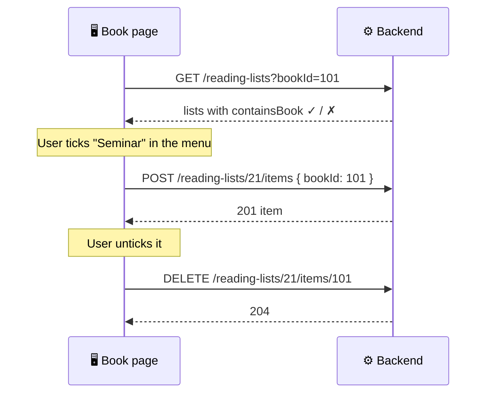

# 🗃️ 05. Reading Lists (Folios)

[← API index](./README.md)

> Curated collections of works: course syllabi, research bibliographies, personal archives.
> Create a list, add and arrange works, annotate them, and decide who can see it.

**Contents**

1. [🧠 Core concepts](#-core-concepts)
2. [🗺️ Endpoints at a glance](#️-endpoints-at-a-glance)
3. [📂 Lists](#-lists)
4. [📑 Items](#-items)
5. [🧾 Overview & recent activity](#-overview--recent-activity)
6. [🤔 Open decisions](#-open-decisions)

---

## 🧠 Core concepts

| | Concept | In one line |
|---|---|---|
| 🗃️ | **Reading list** (folio) | A titled, ordered collection of books owned by one user. |
| 📑 | **Item** | One book in a list, with its position and optional week, note and tag. |
| 🏷️ | **Category** | What the list is for: `COURSE`, `GRANT`, `STUDY`, `ARCHIVE`, `SHARED`. Drives the index filters. |
| 👁️ | **Visibility** | Who can see it: `PRIVATE`, `COHORT`, `PUBLIC`. |
| 👥 | **Collaborator** | Another user with a role on the list (co-instructor, editor). |

```mermaid
erDiagram
    USERS ||--o{ READING_LISTS : owns
    READING_LISTS ||--o{ READING_LIST_ITEMS : contains
    BOOKS ||--o{ READING_LIST_ITEMS : "appears in"
    READING_LISTS ||--o{ LIST_COLLABORATORS : "shared with"
    USERS ||--o{ LIST_COLLABORATORS : "collaborates on"

    READING_LISTS {
        bigint id
        text title
        text description
        varchar category
        varchar visibility
        jsonb settings
        timestamptz updated_at
    }
    READING_LIST_ITEMS {
        int position
        text week
        text note
        text tag
        timestamptz added_at
    }
    LIST_COLLABORATORS {
        varchar role
    }
```



### 👁️ Visibility

| | Value | Who can see it |
|---|---|---|
| 🔒 | `PRIVATE` | Owner and collaborators |
| 🎓 | `COHORT` | + members of the linked course / cohort |
| 🌍 | `PUBLIC` | Any signed-in user |

Only the **owner** (and `EDITOR` collaborators) can change a list. Everyone else gets read-only, or `404` if they can't see it.

---

## 🗺️ Endpoints at a glance

| Group | Method | Path | Purpose |
|---|---|---|---|
| 📂 Lists | `GET` | `/api/v1/reading-lists` | My lists (index page) |
| | `POST` | `/api/v1/reading-lists` | Create a list |
| | `GET` | `/api/v1/reading-lists/{id}` | One list with its items |
| | `PATCH` | `/api/v1/reading-lists/{id}` | Edit details and settings |
| | `DELETE` | `/api/v1/reading-lists/{id}` | Delete a list |
| 📑 Items | `POST` | `/api/v1/reading-lists/{id}/items` | Add a book |
| | `PATCH` | `/api/v1/reading-lists/{id}/items/{bookId}` | Note, week, tag, position |
| | `DELETE` | `/api/v1/reading-lists/{id}/items/{bookId}` | Remove a book |
| 🧾 Overview | `GET` | `/api/v1/reading-lists/recent-items` | "Recent bibliographic ledger" |

---

## 📂 Lists

### `GET /api/v1/reading-lists`

Lists I own or collaborate on, most recently updated first. Paged.

| Param | Example | Meaning |
|---|---|---|
| `category` | `COURSE` | Index filter chips (repeatable) |
| `bookId` | `101` | Adds `containsBook` to each list, for the "Add to list" menu |
| `page`, `size`, `sort` | `sort=updatedAt,desc` | Paging |

```json
{
  "content": [
    {
      "id": 21,
      "title": "Postgraduate Seminar: Ecosystem Dynamics",
      "subtitle": "Foundational Texts",
      "category": "COURSE",
      "visibility": "COHORT",
      "tags": ["ECOL 7010", "2025–26"],
      "itemCount": 18,
      "collaboratorCount": 1,
      "myRole": "OWNER",
      "coverBookIds": [101, 102, 103],
      "updatedAt": "2026-10-31T08:00:00Z",
      "containsBook": true
    }
  ],
  "page": { "size": 20, "number": 0, "totalElements": 6, "totalPages": 1 }
}
```

### `POST /api/v1/reading-lists`

```json
{ "title": "Peatland carbon review", "category": "GRANT", "visibility": "PRIVATE", "bookId": 101 }
```

- Only `title` is required. `bookId` adds a first item (the "New list" option inside "Add to list").
- `201` → the new list (detail shape).

### `GET /api/v1/reading-lists/{id}`

```json
{
  "id": 21,
  "title": "Postgraduate Seminar: Ecosystem Dynamics",
  "subtitle": "Foundational Texts",
  "description": "…",
  "category": "COURSE",
  "visibility": "COHORT",
  "tags": ["ECOL 7010"],
  "owner": { "id": 7, "displayName": "Arpan" },
  "myRole": "OWNER",
  "collaborators": [{ "userId": 9, "displayName": "Dr. Thorne", "role": "EDITOR" }],
  "settings": { "autoSync": true, "notifyMembers": true },
  "items": [
    {
      "book": { "id": 101, "title": "…", "contributors": [{ "name": "Marion Vance", "role": "AUTHOR" }], "publicationYear": 2023, "coverImageUrl": "…", "identifiers": { "doi": "…" } },
      "position": 1,
      "week": "WEEK 02",
      "note": "Read chapters 1–3 before the seminar.",
      "tag": "Assigned • Core",
      "addedAt": "2026-10-01T10:00:00Z"
    }
  ],
  "createdAt": "…",
  "updatedAt": "…"
}
```

- Items come back in `position` order. Sorting by author / year is done on the client.
- Bibliography export (APA, BibTeX…) is built on the client from `items[].book`.

### `PATCH /api/v1/reading-lists/{id}`

Any of: `title`, `subtitle`, `description`, `category`, `visibility`, `tags`, `settings`.

- `200` → the updated list.
- `403` if I can only view it.

### `DELETE /api/v1/reading-lists/{id}`

`204`. Owner only (`403` for collaborators).

---

## 📑 Items



### `POST /api/v1/reading-lists/{id}/items`

```json
{ "bookId": 101, "week": "WEEK 02", "note": "…", "tag": "Assigned • Core" }
```

- Added at the end. `201` → the item.
- `409 ALREADY_IN_LIST` if the book is already there.

### `PATCH /api/v1/reading-lists/{id}/items/{bookId}`

Any of: `week`, `note`, `tag`, `position`.

- Changing `position` moves the item and shifts the others (drag-and-drop reorder).
- `200` → the item.

### `DELETE /api/v1/reading-lists/{id}/items/{bookId}`

`204`. Positions after it close the gap.

---

## 🧾 Overview & recent activity

### `GET /api/v1/reading-lists/recent-items?limit=5`

The "Recent bibliographic ledger": works most recently added across my lists. Plain array.

```json
[
  { "book": { "id": 101, "title": "…" }, "list": { "id": 21, "title": "Foundational Texts" }, "addedAt": "2026-10-31T08:00:00Z" }
]
```

Index-page totals (number of lists, total works) come from the list endpoint's `page.totalElements` and `itemCount`s.

---

## 🤔 Open decisions

| | Decision | Why it matters |
|---|---|---|
| 🎓 | **What is a cohort?** Linked course, department, or hand-picked members? | `COHORT` visibility can't work until it exists. Could ship with `PRIVATE` / `PUBLIC` only. |
| 👥 | **Managing collaborators:** invite by email / ID, roles `EDITOR` / `VIEWER`? | The demo only displays them. Needs `POST/DELETE …/collaborators`. |
| 🔄 | **`autoSync` and `notifyMembers` settings:** what do they actually do? | Shown in the demo with no defined behaviour. Drop until defined? |
| 🔖 | **Saved Items as a built-in list?** | See [06. Saved Items](./06-saved-items.md). |
