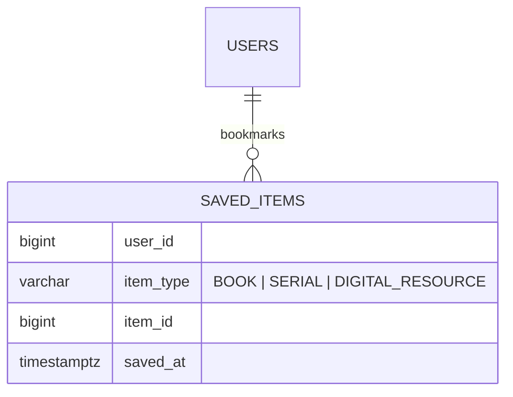
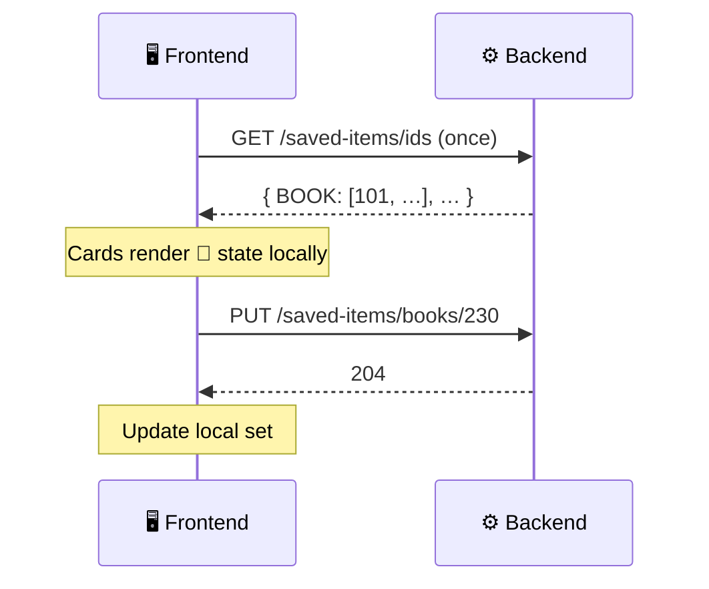

# 🔖 06. Saved Items

[← API index](./README.md)

> One-tap bookmarks: the 🔖 button on book cards, journal cards and digital-resource cards.
> Lighter than a reading list: no order, no notes, no sharing.

**Contents**

1. [🧠 Core concepts](#-core-concepts)
2. [🗺️ Endpoints at a glance](#️-endpoints-at-a-glance)
3. [🔖 Saving & unsaving](#-saving--unsaving)
4. [📋 Listing](#-listing)
5. [🤔 Open decisions](#-open-decisions)

---

## 🧠 Core concepts

A saved item is just **(me, item type, item ID, when)**.

| Item type | Saved from | Points to |
|---|---|---|
| 📕 `BOOK` | Catalog, book detail, new arrivals | [03. Catalog](./03-catalog-discovery.md) |
| 📰 `SERIAL` | Journals page | [11. Journals & Serials](./11-journals-serials.md) |
| 💾 `DIGITAL_RESOURCE` | Digital resources page | [10. Digital Resources](./10-digital-resources.md) |



Unique on `(user_id, item_type, item_id)`, so saving is naturally idempotent.

---

## 🗺️ Endpoints at a glance

| Group | Method | Path | Purpose |
|---|---|---|---|
| 🔖 Toggle | `PUT` | `/api/v1/saved-items/{type}/{itemId}` | Save (idempotent) |
| | `DELETE` | `/api/v1/saved-items/{type}/{itemId}` | Unsave (idempotent) |
| 📋 Listing | `GET` | `/api/v1/saved-items` | My saved items, with summaries |
| | `GET` | `/api/v1/saved-items/ids` | Just the IDs, to light up 🔖 icons |

`{type}` in paths is lowercase: `books`, `serials`, `digital-resources`.

---

## 🔖 Saving & unsaving

### `PUT /api/v1/saved-items/{type}/{itemId}`

```
PUT /api/v1/saved-items/books/101
```

- `204` whether or not it was already saved.
- `404` if the item doesn't exist.

### `DELETE /api/v1/saved-items/{type}/{itemId}`

`204` whether or not it was saved.

> 💡 `PUT` / `DELETE` instead of a "toggle" endpoint: a double-click or a retry can't flip the state back by accident.

---

## 📋 Listing

### `GET /api/v1/saved-items`

| Param | Example | Meaning |
|---|---|---|
| `type` | `BOOK` | Filter by type (repeatable) |
| `page`, `size`, `sort` | `sort=savedAt,desc` | Paging (default newest first) |

```json
{
  "content": [
    { "type": "BOOK", "itemId": 101, "savedAt": "2026-10-30T12:00:00Z",
      "book": { "id": 101, "title": "…", "availability": { "status": "AVAILABLE" } } },
    { "type": "SERIAL", "itemId": 5, "savedAt": "2026-10-28T09:00:00Z",
      "serial": { "id": 5, "title": "Journal of Ecology", "issn": "0022-0477" } }
  ],
  "page": { "size": 20, "number": 0, "totalElements": 2, "totalPages": 1 }
}
```

Each entry carries the summary of exactly one of `book`, `serial`, `digitalResource`, matching `type`.

### `GET /api/v1/saved-items/ids`

Loaded once per app session so every card can show 🔖 filled or empty without asking per card.

```json
{ "BOOK": [101, 104, 230], "SERIAL": [5], "DIGITAL_RESOURCE": [] }
```



---

## 🤔 Open decisions

| | Decision | Why it matters |
|---|---|---|
| 🔀 | **Merge into Reading Lists as a built-in "Saved" list?** | One concept fewer. But lists hold only books today, and saved items also hold serials and digital resources. |
| 📈 | **Cap on saved items?** | `/ids` returns everything; fine for hundreds, not for tens of thousands. |
