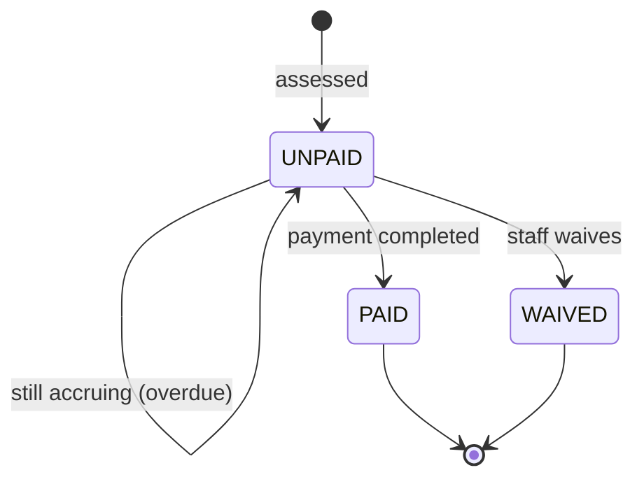
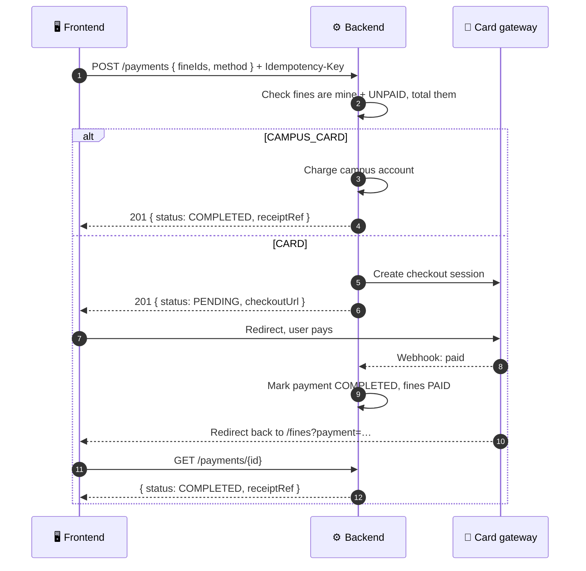

# 💳 07. Fines & Payments

[← API index](./README.md)

> What I owe, why, and paying it off.
> Assessments are created by the library (overdue, lost item, fees); patrons view and pay them.

**Contents**

1. [🧠 Core concepts](#-core-concepts)
2. [🗺️ Endpoints at a glance](#️-endpoints-at-a-glance)
3. [🧾 Fines](#-fines)
4. [💸 Payments](#-payments)
5. [🤔 Open decisions](#-open-decisions)

---

## 🧠 Core concepts

| | Concept | In one line |
|---|---|---|
| 🧾 | **Fine** (assessment) | One charge on my account, with a reason and an amount. |
| 💸 | **Payment** | Money received against one or more fines. Has a transaction and receipt reference. |
| 💰 | **Balance** | Sum of my unpaid fines. Feeds my [borrowing status](./04-circulation.md#-borrowing-status). |

### 🔄 Fine lifecycle



| Reason | Example |
|---|---|
| ⏰ `OVERDUE` | Recalled item returned late; accrues per day |
| 📦 `LOST_ITEM` | Replacement cost |
| 🧾 `PROCESSING_FEE` | Admin fee on a lost or damaged item |
| 📚 `BINDING_DAMAGE` | Damage assessment |
| 💾 `DIGITAL_FEE` | Document delivery / ILL fee |

---

## 🗺️ Endpoints at a glance

| Group | Method | Path | Purpose |
|---|---|---|---|
| 🧾 Fines | `GET` | `/api/v1/fines` | My fines |
| | `GET` | `/api/v1/fines/summary` | Outstanding and settled totals |
| 💸 Payments | `GET` | `/api/v1/payments` | My payment history |
| | `POST` | `/api/v1/payments` | Pay selected fines |
| | `GET` | `/api/v1/payments/{id}` | One payment (status, receipt) |

---

## 🧾 Fines

### `GET /api/v1/fines`

| Param | Example | Meaning |
|---|---|---|
| `status` | `UNPAID` | Filter (repeatable). Default: all. |
| `reason` | `OVERDUE` | Filter chips (repeatable) |
| `page`, `size`, `sort` | `sort=assessedOn,desc` | Paging |

```json
{
  "content": [
    {
      "id": 801,
      "reason": "OVERDUE",
      "status": "UNPAID",
      "amount": { "amount": "12.50", "currency": "USD" },
      "originalAmount": null,
      "assessedOn": "2026-10-03",
      "daysOverdue": 25,
      "accruing": true,
      "book": { "id": 101, "title": "…" },
      "barcode": "31234009876543",
      "note": "Recalled for course reserve; returned 25 days late."
    }
  ],
  "page": { "size": 20, "number": 0, "totalElements": 4, "totalPages": 1 }
}
```

- `originalAmount` is set when part was waived or reduced.
- `accruing: true` means the amount may still grow (item not yet returned).

### `GET /api/v1/fines/summary`

```json
{
  "outstanding": { "amount": "37.50", "currency": "USD" },
  "settledTotal": { "amount": "64.00", "currency": "USD" },
  "unpaidCount": 3
}
```

Standing and borrow limit are in [`/borrowing-status`](./04-circulation.md#-borrowing-status).

---

## 💸 Payments

### `POST /api/v1/payments`

Pay some or all unpaid fines.

```json
{ "fineIds": [801, 802], "method": "CAMPUS_CARD" }
```

Header: **`Idempotency-Key: <uuid>`** (required). A retried request with the same key returns the first result instead of charging twice.



**Response** `201`

```json
{
  "id": 950,
  "status": "PENDING",
  "method": "CARD",
  "amount": { "amount": "37.50", "currency": "USD" },
  "fineIds": [801, 802],
  "checkoutUrl": "https://pay.example.com/c/…",
  "transactionRef": null,
  "receiptRef": null,
  "createdAt": "2026-11-01T10:00:00Z",
  "completedAt": null
}
```

| `409` code | When |
|---|---|
| `FINE_NOT_PAYABLE` | A fine is already paid or waived |
| `AMOUNT_CHANGED` | An accruing fine grew since the page loaded; reload and confirm |

| `method` | Flow |
|---|---|
| 🎓 `CAMPUS_CARD` | Charged to the university account, completes immediately |
| 💳 `CARD` | Hosted checkout page, completes via webhook |

### `GET /api/v1/payments`

Payment history, newest first. Paged.

```json
{
  "content": [
    {
      "id": 940,
      "status": "COMPLETED",
      "method": "CAMPUS_CARD",
      "amount": { "amount": "18.00", "currency": "USD" },
      "transactionRef": "TXN-98214",
      "receiptRef": "RC-4491",
      "fines": [{ "id": 790, "reason": "LOST_ITEM", "book": { "id": 88, "title": "…" } }],
      "completedAt": "2026-09-12T14:20:00Z"
    }
  ],
  "page": { "size": 20, "number": 0, "totalElements": 5, "totalPages": 1 }
}
```

### `GET /api/v1/payments/{id}`

Same shape as one history entry. The frontend polls this after returning from the card gateway.

---

## 🤔 Open decisions

| | Decision | Why it matters |
|---|---|---|
| 🏦 | **Card provider:** which gateway (Stripe, Razorpay, university bursar)? | Shapes the checkout and webhook endpoints. |
| 🎓 | **Campus card:** is there an API to charge it, or is it a desk-only method? | If desk-only, patrons can't pay it online. |
| ⏰ | **Who assesses fines?** A nightly job for overdue accrual + staff for damage / lost items? | Also creates notifications ([09](./09-notifications.md)). |
| 🧾 | **Receipts:** PDF download endpoint, or emailed only? | `GET /payments/{id}/receipt` if needed. |
| 💱 | **Currency:** single currency per institution? | Keeps `amount` maths simple. |
