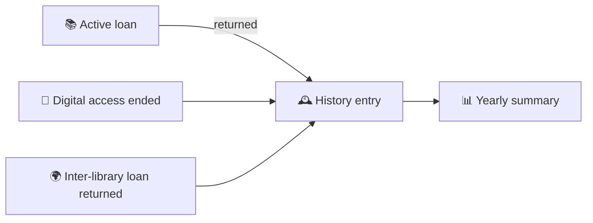

# 🕰️ 08. Reading History

[← API index](./README.md)

> Everything I've borrowed and returned, and a yearly summary of my reading.
> Read-only. History is what's left of a loan after it's returned.

**Contents**

1. [🧠 Core concepts](#-core-concepts)
2. [🗺️ Endpoints at a glance](#️-endpoints-at-a-glance)
3. [📜 History](#-history)
4. [📊 Yearly summary](#-yearly-summary)
5. [🤔 Open decisions](#-open-decisions)

---

## 🧠 Core concepts



| Format | Comes from |
|---|---|
| 📕 `PHYSICAL` | Returned physical loans |
| 💾 `DIGITAL` | Ended digital loans |
| 🌍 `ILL` | Inter-library loans (borrowed from another library) |

> 💡 History can be a **view over returned loans** (`loans.returned_at IS NOT NULL`) rather than a separate table, as long as returned loans are never deleted.

---

## 🗺️ Endpoints at a glance

| Group | Method | Path | Purpose |
|---|---|---|---|
| 📜 History | `GET` | `/api/v1/history` | My past borrowings |
| 📊 Summary | `GET` | `/api/v1/history/summary` | Yearly reading stats |

---

## 📜 History

### `GET /api/v1/history`

| Param | Example | Meaning |
|---|---|---|
| `format` | `PHYSICAL` | Format chips (repeatable) |
| `q` | `peat` | Search within my history (title, author) |
| `from`, `to` | `2026-01-01` | Returned within a date range |
| `page`, `size`, `sort` | `sort=returnedOn,desc` | `returnedOn` (default), `title` |

```json
{
  "content": [
    {
      "id": 3001,
      "format": "PHYSICAL",
      "book": { "id": 101, "title": "…", "contributors": [{ "name": "Marion Vance", "role": "AUTHOR" }], "publisher": "Oxford University Press", "publicationYear": 2023 },
      "borrowedOn": "2026-08-01",
      "returnedOn": "2026-08-29",
      "loanDays": 28,
      "branch": { "id": 1, "name": "Central Library" },
      "barcode": "31234009876543",
      "sourceLibrary": null
    }
  ],
  "page": { "size": 10, "number": 0, "totalElements": 46, "totalPages": 5 }
}
```

- `id` is the original loan ID.
- `sourceLibrary` is set for `ILL`, e.g. "Bodleian Libraries".

---

## 📊 Yearly summary

### `GET /api/v1/history/summary?year=2026`

`year` defaults to the current year.

```json
{
  "year": 2026,
  "worksRead": 46,
  "changeFromPreviousYear": 8,
  "byFormat": { "PHYSICAL": 30, "DIGITAL": 14, "ILL": 2 },
  "averageLoanDays": 19.4,
  "goal": { "target": 60, "current": 46 },
  "topSubjects": [
    { "subject": "Ecology", "count": 18 },
    { "subject": "Climate Adaptation", "count": 9 }
  ]
}
```

- `goal` is `null` if I haven't set one.

---

## 🤔 Open decisions

| | Decision | Why it matters |
|---|---|---|
| 🔏 | **Privacy:** can patrons turn history off, or clear it? Libraries often default to *not* keeping it. | May add a setting in [02](./02-profile-settings.md) and `DELETE /history`. Also decides whether returned loans are anonymised. |
| 🎯 | **Reading goal:** where is `target` set? | Needs a setting (or drop `goal`). |
| 🧮 | **Summary cost:** compute on request, or keep yearly counters? | Fine on request at patron scale; revisit if slow. |
