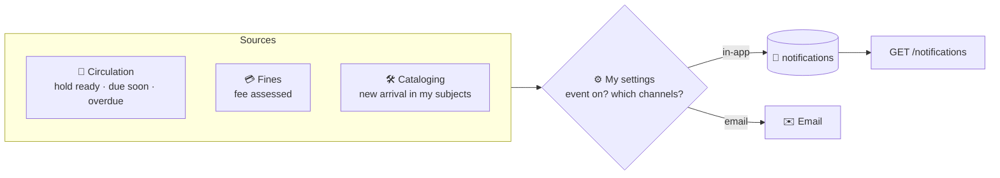

# 🔔 09. Notifications

[← API index](./README.md)

> The bell in the top bar: holds ready, loans due, overdue items, fees, new arrivals.
> Other groups *create* notifications; this group lets the user read and dismiss them.

**Contents**

1. [🧠 Core concepts](#-core-concepts)
2. [🗺️ Endpoints at a glance](#️-endpoints-at-a-glance)
3. [📥 Feed](#-feed)
4. [✅ Marking read](#-marking-read)
5. [🤔 Open decisions](#-open-decisions)

---

## 🧠 Core concepts



| Kind | Category | Points to |
|---|---|---|
| 📦 `HOLD_READY` | `CIRCULATION` | Hold |
| ⏰ `LOAN_DUE_SOON` | `CIRCULATION` | Loan |
| 🚨 `OVERDUE` | `CIRCULATION` | Loan |
| 💳 `FEE_ASSESSED` | `CIRCULATION` | Fine |
| 🆕 `NEW_ARRIVAL` | `ACQUISITIONS` | Book |

Preferences (which kinds, which channels) live in [02. Profile & Settings](./02-profile-settings.md#️-settings).

### 🎨 Actions are derived, not stored

The demo's buttons ("Renew", "View pickup code", "Save") come from **`kind` + `subject`** on the frontend and call the normal endpoints (e.g. `POST /loans/{id}/renew`). Notifications carry no button definitions.

---

## 🗺️ Endpoints at a glance

| Group | Method | Path | Purpose |
|---|---|---|---|
| 📥 Feed | `GET` | `/api/v1/notifications` | My notifications |
| | `GET` | `/api/v1/notifications/unread-count` | Number on the bell |
| ✅ Read | `POST` | `/api/v1/notifications/{id}/read` | Mark one read |
| | `POST` | `/api/v1/notifications/read-all` | Mark all read |

---

## 📥 Feed

### `GET /api/v1/notifications`

| Param | Example | Meaning |
|---|---|---|
| `unread` | `true` | Only unread ("Unread" chip) |
| `category` | `CIRCULATION` | Category chips |
| `page`, `size` | `0`, `20` | Paging; always newest first |

```json
{
  "content": [
    {
      "id": 7001,
      "kind": "HOLD_READY",
      "category": "CIRCULATION",
      "title": "Your hold is ready for pickup",
      "message": "Collect it from Central Library, Main Floor, West Wing.",
      "subject": { "type": "HOLD", "id": 4001 },
      "book": { "id": 102, "title": "…" },
      "actionNeeded": true,
      "createdAt": "2026-11-01T09:35:00Z",
      "readAt": null
    }
  ],
  "page": { "size": 20, "number": 0, "totalElements": 9, "totalPages": 1 }
}
```

- "Today" / "Earlier this week" grouping and "25m ago" are computed on the client from `createdAt`.
- `book` is included when the subject relates to one, so the panel needs no extra calls.

### `GET /api/v1/notifications/unread-count`

```json
{ "count": 3 }
```

Cheap; the frontend polls it (e.g. every 60 s and on window focus).

---

## ✅ Marking read

### `POST /api/v1/notifications/{id}/read`

`204`. Idempotent. `404` if not mine.

### `POST /api/v1/notifications/read-all`

`204`. Marks everything currently unread as read.

---

## 🤔 Open decisions

| | Decision | Why it matters |
|---|---|---|
| ⚡ | **Live updates:** polling `unread-count`, or Server-Sent Events (`GET /notifications/stream`)? | Polling is simplest; SSE gives instant badges. |
| 🗑️ | **Retention:** delete read notifications after N days? | Keeps the table small. |
| 🔁 | **Resolved notifications:** should "loan due" disappear once renewed? | The demo shows a "Resolved" group; needs a `resolvedAt` set by circulation. |
| ✉️ | **Email delivery:** which provider, and templated where? | Only matters once email is on. |
