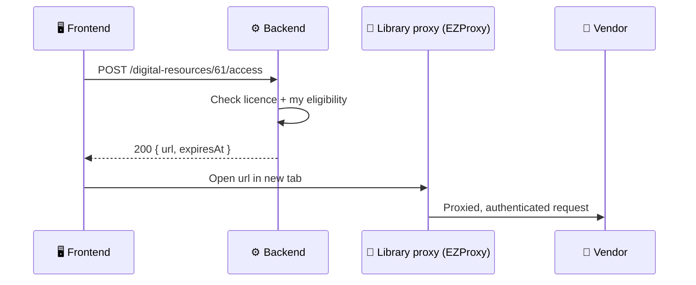

# 💾 10. Digital Resources

[← API index](./README.md)

> Licensed and open online collections: e-book platforms, research databases, theses repositories and datasets.
> Browse them, filter by access type, and launch one through the library's proxy.

**Contents**

1. [🧠 Core concepts](#-core-concepts)
2. [🗺️ Endpoints at a glance](#️-endpoints-at-a-glance)
3. [📋 Browse](#-browse)
4. [🚀 Access](#-access)
5. [🤔 Open decisions](#-open-decisions)

---

## 🧠 Core concepts

A digital resource is a **platform or collection**, not a single book: "JSTOR", "ProQuest Dissertations", "Dryad datasets".

| Type | Example |
|---|---|
| 📘 `EBOOK` | Oxford Scholarship Online |
| 🗄️ `DATABASE` | JSTOR, Web of Science |
| 🎓 `THESIS` | ProQuest Dissertations & Theses |
| 📊 `DATASET` | Dryad, institutional data repository |

| Access | Meaning |
|---|---|
| 🏛️ `INSTITUTIONAL` | Licensed; must go through the library proxy / SSO |
| 🔓 `OPEN` | Free; direct link |

---

## 🗺️ Endpoints at a glance

| Group | Method | Path | Purpose |
|---|---|---|---|
| 📋 Browse | `GET` | `/api/v1/digital-resources` | List / filter, with per-type counts |
| | `GET` | `/api/v1/digital-resources/{id}` | One resource |
| 🚀 Access | `POST` | `/api/v1/digital-resources/{id}/access` | Get a launch URL |

---

## 📋 Browse

### `GET /api/v1/digital-resources`

| Param | Example | Meaning |
|---|---|---|
| `type` | `DATABASE` | The tabs |
| `access` | `INSTITUTIONAL` | Filter chips |
| `peerReviewed` | `true` | Filter chip |
| `apiAccess` | `true` | "API / Raw data" chip |
| `subject` | `ecology` | Subject filter |
| `q` | `soil` | Text search over title, vendor, description |
| `sort` | `curated` · `title,asc` · `addedAt,desc` | Default `curated` (librarian order) |
| `page`, `size` | | Paging |

```json
{
  "content": [
    {
      "id": 61,
      "type": "DATABASE",
      "title": "JSTOR Arts & Sciences",
      "description": "…",
      "vendor": "ITHAKA",
      "collection": "Core Collection",
      "access": "INSTITUTIONAL",
      "scope": "CAMPUS_AND_REMOTE",
      "subjects": ["Ecology", "History of Science"],
      "peerReviewed": true,
      "apiAccess": false,
      "addedAt": "2025-02-10T00:00:00Z"
    }
  ],
  "page": { "size": 12, "number": 0, "totalElements": 412, "totalPages": 35 },
  "facets": {
    "type": [{ "key": "EBOOK", "count": 1820 }, { "key": "DATABASE", "count": 412 }, { "key": "THESIS", "count": 96 }, { "key": "DATASET", "count": 58 }]
  }
}
```

- `facets.type` gives the tab counts ("412 Active").

### `GET /api/v1/digital-resources/{id}`

Same shape as a list item, plus `coverage` (years / titles included) and `usageNotes`.

---

## 🚀 Access

### `POST /api/v1/digital-resources/{id}/access`



```json
{ "url": "https://proxy.lib.uni.edu/login?url=https://www.jstor.org/…", "expiresAt": "2026-11-01T10:05:00Z" }
```

- `POST`, not a `302`: the frontend calls the API with a bearer header, so a redirect response can't be followed into a new tab.
- Gives one place to log usage and enforce licence rules later.
- `OPEN` resources return their direct URL.
- `403 NOT_LICENSED_FOR_USER` if my account type isn't covered.

---

## 🤔 Open decisions

| | Decision | Why it matters |
|---|---|---|
| 📕 | **E-books here vs in the catalog:** a single e-book is a catalog book with `ONLINE` availability. Is `EBOOK` here only for *platforms*? | Avoids the same title in two places. |
| 🔐 | **Proxy:** EZProxy, OpenAthens, or none at first? | Decides how `url` is built. |
| 🗂️ | **Who maintains this list?** Admin CRUD endpoints, or imported from a knowledge base (e.g. KBART files)? | Needs admin endpoints either way. |
