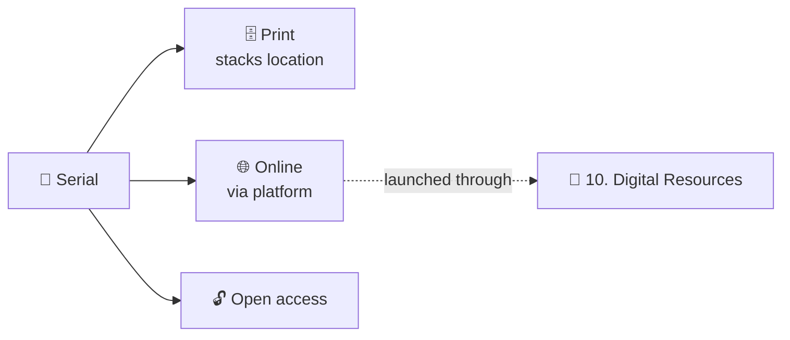

# 📰 11. Journals & Serials

[← API index](./README.md)

> Journal titles the library holds or subscribes to: impact, holdings range, access options.
> Find a journal by title, subject or ISSN, and see whether it's in print, online or open access.

**Contents**

1. [🧠 Core concepts](#-core-concepts)
2. [🗺️ Endpoints at a glance](#️-endpoints-at-a-glance)
3. [📋 Browse & look up](#-browse--look-up)
4. [🤔 Open decisions](#-open-decisions)

---

## 🧠 Core concepts

| | Concept | In one line |
|---|---|---|
| 📰 | **Serial** | A journal title (not an issue or article). Identified by ISSN / e-ISSN. |
| 🗓️ | **Holdings** | Which years the library has, e.g. `1913–present`. |
| 🧭 | **Access** | Print in the stacks, full text online, open access, or a mix. |
| 📈 | **Metrics** | Impact factor, SJR quartile, indexing (Scopus / Web of Science). |



Saving a journal uses [06. Saved Items](./06-saved-items.md) with type `SERIAL`.

---

## 🗺️ Endpoints at a glance

| Group | Method | Path | Purpose |
|---|---|---|---|
| 📋 Browse | `GET` | `/api/v1/serials` | List / filter / sort; also ISSN lookup |
| | `GET` | `/api/v1/serials/{id}` | One serial |

---

## 📋 Browse & look up

### `GET /api/v1/serials`

| Param | Example | Meaning |
|---|---|---|
| `q` | `ecology` | Title / publisher search |
| `issn` | `0022-0477` | **ISSN lookup** (matches print or e-ISSN) |
| `subject` | `ecology` | Discipline filter |
| `peerReviewed`, `openAccess`, `fullText`, `print`, `indexed` | `true` | Filter chips |
| `sort` | `title,asc` · `impactFactor,desc` · `holdingsFrom,asc` | Default: relevance with `q`, else title |
| `page`, `size` | | Paging |

```json
{
  "content": [
    {
      "id": 5,
      "title": "Journal of Ecology",
      "publisher": "Wiley",
      "publisherOnBehalfOf": "British Ecological Society",
      "issn": "0022-0477",
      "eIssn": "1365-2745",
      "subjects": ["Ecology", "Plant Science"],
      "metrics": { "impactFactor": 5.5, "sjrQuartile": "Q1" },
      "holdings": { "from": 1913, "to": null, "summary": "Vol. 1 (1913) – present" },
      "access": { "print": true, "fullText": true, "openAccess": false },
      "stacksLocation": "Science Library, Level 2, Periodicals",
      "peerReviewed": true,
      "indexed": true
    }
  ],
  "page": { "size": 10, "number": 0, "totalElements": 238, "totalPages": 24 }
}
```

**🔢 ISSN modal** = `GET /api/v1/serials?issn=0022-0477`

- One match → open it.
- Zero → "Not held; request via inter-library loan".

### `GET /api/v1/serials/{id}`

Same shape as a list item. `404` if unknown.

---

## 🤔 Open decisions

| | Decision | Why it matters |
|---|---|---|
| 🕘 | **"Recently viewed" panel:** keep it in the browser (localStorage), or server-side? | Client-side needs no API. Server-side only if it must follow the user across devices. |
| 📚 | **Serials in the catalog?** Could be catalog books with `type=JOURNAL`. | Separate model fits better: ISSN, holdings ranges and metrics don't map to `books`. |
| 📈 | **Metrics source:** manual entry, or imported (JCR, SCImago)? | Licensing and refresh frequency. |
| 📖 | **Issues and articles:** browse issues inside the app, or link out to the platform? | The demo's "Browse issues" goes nowhere yet. |
