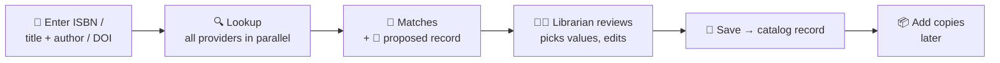
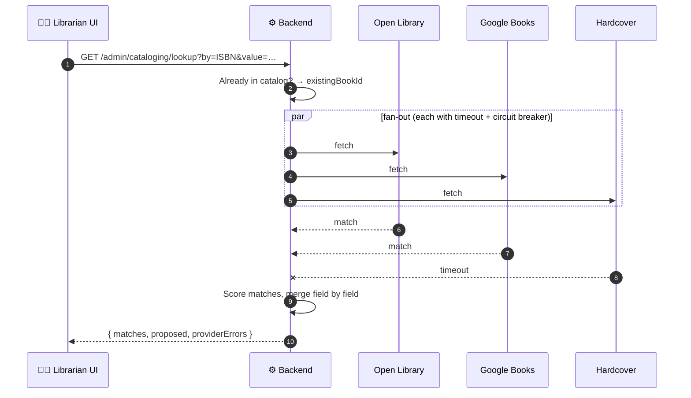

# 🛠️ 12. Admin: Cataloging

[← API index](./README.md)

> Librarian tools for adding books to the catalog.
> Look a book up across external metadata providers, compare what they say, pick the best value per field, and save it as a catalog record.

**Contents**

1. [🧠 Core concepts](#-core-concepts)
2. [🗺️ Endpoints at a glance](#️-endpoints-at-a-glance)
3. [🔌 Providers](#-providers)
4. [🔍 Lookup](#-lookup)
5. [💾 Saving records](#-saving-records)
6. [🤔 Open decisions](#-open-decisions)

---

## 🧠 Core concepts

| | Concept | In one line |
|---|---|---|
| 🔌 | **Provider** | An external metadata source: Open Library, Google Books, Hardcover, Comic Vine, RanobeDB. |
| 🎯 | **Match** | One provider's version of the book, with a confidence score. |
| 🧩 | **Proposed record** | Our best merge of all matches, field by field, with conflicts flagged. |
| ✅ | **Catalog record** | What the librarian saves: a row in `books` + its contributors. |

### 🔁 The cataloging flow



🔒 Everything here needs a **staff role** (`403` otherwise).

---

## 🗺️ Endpoints at a glance

| Group | Method | Path | Purpose |
|---|---|---|---|
| 🔌 Providers | `GET` | `/api/v1/admin/metadata-providers` | Which providers exist and are enabled |
| 🔍 Lookup | `GET` | `/api/v1/admin/cataloging/lookup` | Search providers, get matches + proposed record |
| 💾 Records | `POST` | `/api/v1/admin/books` | Create a catalog record |
| | `PATCH` | `/api/v1/admin/books/{id}` | Edit a catalog record |

---

## 🔌 Providers

### `GET /api/v1/admin/metadata-providers`

Drives the provider toggles on the lookup screen. Plain array.

```json
[
  { "key": "OPEN_LIBRARY", "name": "Open Library", "enabled": true, "lookupTypes": ["ISBN", "TITLE_AUTHOR"], "mediaTypes": ["GENERAL", "EBOOK"] },
  { "key": "GOOGLE_BOOKS", "name": "Google Books", "enabled": true, "lookupTypes": ["ISBN", "TITLE_AUTHOR"], "mediaTypes": ["GENERAL", "EBOOK"] },
  { "key": "HARDCOVER", "name": "Hardcover", "enabled": true, "lookupTypes": ["ISBN", "TITLE_AUTHOR"], "mediaTypes": ["GENERAL"] },
  { "key": "COMIC_VINE", "name": "Comic Vine", "enabled": true, "lookupTypes": ["TITLE_AUTHOR"], "mediaTypes": ["COMICS"] },
  { "key": "RANOBEDB", "name": "RanobeDB", "enabled": true, "lookupTypes": ["ISBN", "TITLE_AUTHOR"], "mediaTypes": ["GENERAL"] }
]
```

> 📝 **Note:** these five clients already exist in the backend (`MetadataClient` implementations).

---

## 🔍 Lookup

### `GET /api/v1/admin/cataloging/lookup`

| Param | Example | Meaning |
|---|---|---|
| `by` | `ISBN` | `ISBN` · `TITLE_AUTHOR` · `ASIN` · `DOI` (the lookup tabs) |
| `value` | `9780198834922` | The identifier, or the title |
| `author` | `Vance` | With `TITLE_AUTHOR` |
| `mediaType` | `GENERAL` | `GENERAL` · `COMICS` · `AUDIO` · `EBOOK`; narrows providers |
| `provider` | `OPEN_LIBRARY` | Limit to these (repeatable). Default: all enabled for the media type. |



**Response** `200`

```json
{
  "existingBookId": null,
  "matches": [
    {
      "provider": "OPEN_LIBRARY",
      "confidence": 0.94,
      "record": {
        "title": "Ecosystem Resilience in a Changing World",
        "subtitle": "Thresholds, Feedbacks and Recovery",
        "authors": [{ "name": "Marion Vance", "role": "AUTHOR" }],
        "publisher": "Oxford University Press",
        "publicationYear": 2023,
        "pageCount": 412,
        "language": "en",
        "identifiers": { "isbn13": "9780198834922", "olid": "OL123M" },
        "classification": { "dewey": "577.18", "lcc": "QH541" },
        "subjects": ["Ecology"],
        "description": "…",
        "coverImageUrl": "…"
      }
    }
  ],
  "proposed": {
    "title":           { "value": "Ecosystem Resilience in a Changing World", "sources": ["OPEN_LIBRARY", "GOOGLE_BOOKS"], "conflicts": [] },
    "publicationYear": { "value": 2023, "sources": ["OPEN_LIBRARY"],
                         "conflicts": [{ "provider": "GOOGLE_BOOKS", "value": 2022 }] }
  },
  "providerErrors": [{ "provider": "HARDCOVER", "code": "TIMEOUT" }]
}
```

| Part | Used for |
|---|---|
| `existingBookId` | ⚠️ "Already in the catalog": link to it instead of creating a duplicate |
| `matches` | The provider cards, sorted by `confidence` |
| `proposed` | Pre-fills the form; `conflicts` power the "pick a value" chips |
| `providerErrors` | Show which sources were skipped; the lookup still succeeds |

- A provider failing never fails the lookup. All providers failing → `502 PROVIDERS_UNAVAILABLE`.
- `GET` because it changes nothing; results can be cached briefly per identifier.

---

## 💾 Saving records

### `POST /api/v1/admin/books`

The form as the librarian finalised it.

```json
{
  "title": "Ecosystem Resilience in a Changing World",
  "subtitle": "Thresholds, Feedbacks and Recovery",
  "contributors": [{ "name": "Marion Vance", "role": "AUTHOR" }],
  "publisher": "Oxford University Press",
  "publicationYear": 2023,
  "edition": "3rd Revised Edition",
  "pageCount": 412,
  "language": "en",
  "identifiers": { "isbn13": "9780198834922", "isbn10": "0198834926", "olid": "OL123M" },
  "classification": { "dewey": "577.18", "lcc": "QH541 .V36 2023" },
  "series": { "name": "Oxford Ecology Series", "number": 14 },
  "subjects": ["Ecology", "Climate Adaptation"],
  "description": "…",
  "coverImageUrl": "…",
  "sourceProvider": "OPEN_LIBRARY"
}
```

- Contributors are matched to existing `authors` by name / OLID, or created.
- `201` → the book in the [catalog detail shape](./03-catalog-discovery.md#-book-detail).

| Error | When |
|---|---|
| `400 VALIDATION_FAILED` | Missing title, bad ISBN checksum, year out of range |
| `409 DUPLICATE_IDENTIFIER` | ISBN / ASIN / OLID already used; body includes `existingBookId` |

### `PATCH /api/v1/admin/books/{id}`

Same fields as create, any subset. `200` → updated book. Same errors.

---

## 🤔 Open decisions

| | Decision | Why it matters |
|---|---|---|
| 👮 | **Roles:** where do staff roles live (`users.role`, a `user_roles` table, or from SSO groups)? | Every `/admin` endpoint depends on it. |
| 📦 | **Copies / accessioning:** `POST /admin/books/{id}/copies` (barcode, branch, call number)? | Without copies nothing shows as available. Not in the demo yet. |
| 📝 | **Drafts:** save half-finished records server-side? | The demo keeps the form in the browser only. |
| 🧩 | **Merge strategy per field:** priority, first non-null, voting, or AI-assisted? | The previous backend had resolver strategies for this; decide which return. |
| ✍️ | **Author matching:** how sure must a name match be before reusing an existing author? | Avoids duplicate authors vs merging different people. |
| 🗑️ | **Delete / withdraw records:** hard delete, or a `withdrawn` status? | Loans and history reference books. |
