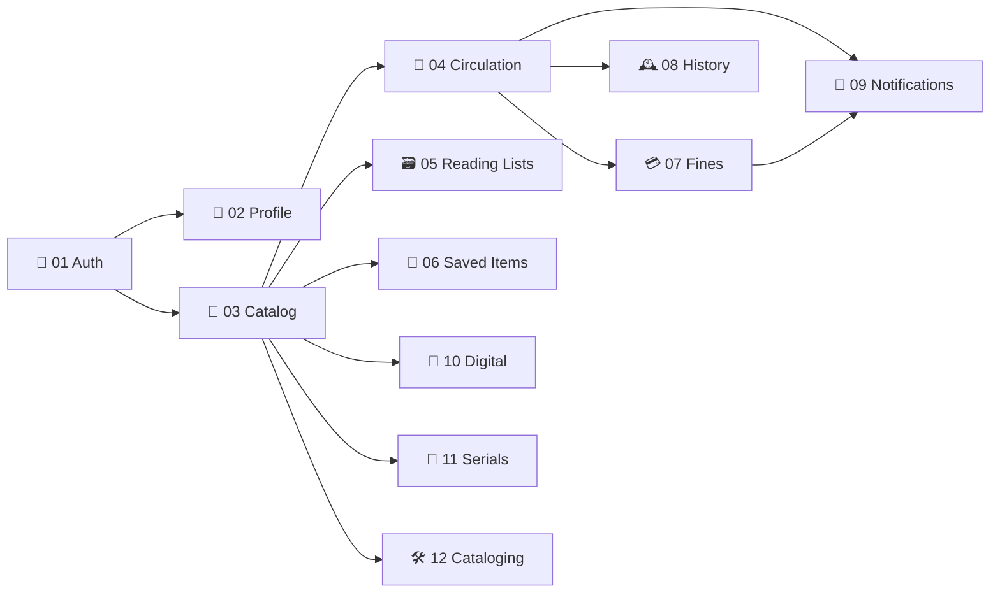

# 📚 OpenShelves API Design

The REST API between the OpenShelves frontend and the Spring Boot backend.
Derived from the demo site (`openshelves-demo-site`: what each screen reads and does) and shaped for the backend we want, not the one we have today.

**Contents**

1. [🗂️ Groups](#️-groups)
2. [🧭 How the groups depend on each other](#-how-the-groups-depend-on-each-other)
3. [📏 Conventions (apply to every group)](#-conventions-apply-to-every-group)
4. [✂️ Scope notes](#️-scope-notes)

---

## 🗂️ Groups

| # | | Group | What it covers | Base path |
|---|---|---|---|---|
| 01 | 🔐 | [Auth & Sessions](./01-auth-sessions.md) | Sign in/out, current session, signed-in devices, SSO | `/auth` |
| 02 | 👤 | [Profile & Settings](./02-profile-settings.md) | Who you are, and how the app behaves for you | `/profile`, `/settings` |
| 03 | 🔎 | [Catalog & Discovery](./03-catalog-discovery.md) | Search, book detail, new arrivals, recommendations | `/books` |
| 04 | 🔄 | [Circulation](./04-circulation.md) | Loans, renewals, holds, branches, borrowing status | `/loans`, `/holds`, `/branches` |
| 05 | 🗃️ | [Reading Lists](./05-reading-lists.md) | Folios: create, curate, share | `/reading-lists` |
| 06 | 🔖 | [Saved Items](./06-saved-items.md) | Bookmarks across books, journals, digital resources | `/saved-items` |
| 07 | 💳 | [Fines & Payments](./07-fines-payments.md) | Assessments, balance, paying | `/fines`, `/payments` |
| 08 | 🕰️ | [Reading History](./08-reading-history.md) | Past borrowings and yearly summary | `/history` |
| 09 | 🔔 | [Notifications](./09-notifications.md) | Feed, unread count, mark read | `/notifications` |
| 10 | 💾 | [Digital Resources](./10-digital-resources.md) | E-books, databases, theses, datasets | `/digital-resources` |
| 11 | 📰 | [Journals & Serials](./11-journals-serials.md) | Serial titles, ISSN lookup | `/serials` |
| 12 | 🛠️ | [Admin: Cataloging](./12-admin-cataloging.md) | Librarian tools: provider lookup, adding records | `/admin` |

---

## 🧭 How the groups depend on each other



**Build order:** 01 → 02 → 03 → 04 → 05, then the rest. Almost everything references a book, and most of the patron side hangs off circulation.

---

## 📏 Conventions (apply to every group)

### 🌐 Base path & auth

- Everything lives under **`/api/v1`**. Paths in the group pages are written in full.
- Every endpoint needs `Authorization: Bearer <token>` unless marked **🌐 Public**. See [01. Auth & Sessions](./01-auth-sessions.md).

### 👤 "My" data is implicit

Patron-facing resources are **scoped to the signed-in user** by the token. No user ID in the path.

```
GET /api/v1/loans          → my loans
GET /api/v1/fines          → my fines
```

Staff tools that act on *other* users or on the catalog live under **`/api/v1/admin/...`** and need a staff role.

### 🆔 IDs, dates, money

| What | Format | Example |
|---|---|---|
| IDs | Number (Postgres `BIGINT`) | `42` |
| Timestamps | ISO-8601 UTC instant, field ends in `At` | `"dueAt": "2026-11-27T18:30:00Z"` |
| Dates without time | ISO-8601 date, field ends in `On` | `"assessedOn": "2026-10-03"` |
| Money | Decimal string + ISO currency | `{ "amount": "12.50", "currency": "USD" }` |
| Enums | `UPPER_SNAKE_CASE` | `"READY"`, `"OVERDUE"` |

### 📄 Pagination & sorting

Lists that can grow use Spring's page parameters and `PagedModel` shape:

```
GET /api/v1/books?page=0&size=24&sort=publicationYear,desc
```

```json
{
  "content": [ { "id": 101, "title": "…" } ],
  "page": { "size": 24, "number": 0, "totalElements": 312, "totalPages": 13 }
}
```

- `page` is **0-based**.
- Small, bounded lists (my active loans, my holds, branches) return a **plain array**. Each page says which.
- Search-style lists may add a **`facets`** object next to `content` (counts per filter value).

### ❗ Errors

Every error uses one body (RFC 9457 problem details + `code`):

```json
{
  "title": "Conflict",
  "status": 409,
  "detail": "This item already has a hold.",
  "instance": "/api/v1/holds",
  "code": "HOLD_EXISTS",
  "timestamp": "2026-11-01T10:00:00Z"
}
```

| Status | Used for |
|---|---|
| `400` | Validation failed (`VALIDATION_FAILED`) |
| `401` | Not signed in, or sign-in failed (see Auth for codes) |
| `403` | Signed in but not allowed (e.g. not staff) |
| `404` | Not found, **or not yours** (never reveal other users' data) |
| `409` | Business rule / state conflict; **branch on `code`** |

### 🎨 Data, not presentation

The API returns **domain data**; the frontend derives display text.
The demo's UI-only fields (`availabilityLabel`, `ageLabel`, `iconTone`, `catalogCard`, "Edited 2h ago"…) are **not** part of the API.

---

## ✂️ Scope notes

| | Item | Decision |
|---|---|---|
| 🚫 | Citations (APA / MLA / Chicago / BibTeX) | Generated on the client from book data. No endpoint. |
| ⏸️ | Librarian Chat | Mocked replies in the demo. Deferred. |
| ⏸️ | Checkout & return at the desk | Staff workflow; not in the demo. Added to Circulation later. |
| 🤔 | Saved Items vs Reading Lists | Could merge into a default "Saved" list. See [06](./06-saved-items.md). |
| 🤔 | Journals & Digital Resources vs Catalog | Could start as filtered catalog views. See [10](./10-digital-resources.md) / [11](./11-journals-serials.md). |
