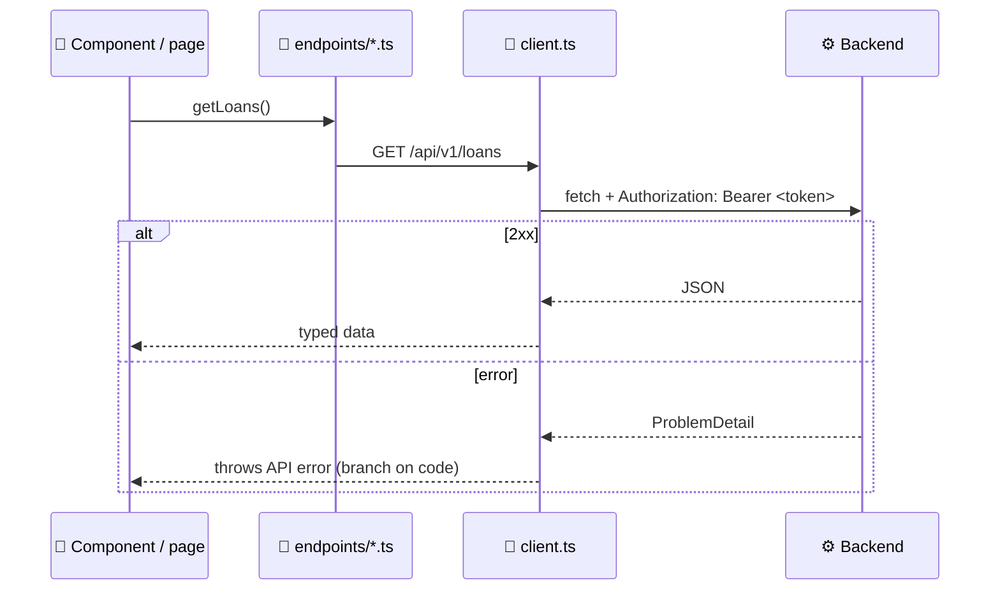

# 🖥️ OpenShelves Frontend

[← Project README](../README.md)

The OpenShelves web app: what patrons and librarians use in the browser. It talks to the [backend API](../backend/README.md) over REST.

> [!NOTE]
> **Early scaffold.** The app currently renders a placeholder page. The UI is being rebuilt from the [demo site](../docs/poc/demo-site/README.md) against the real API ([API design](../docs/api-design/README.md)).

**Contents**

1. [🛠️ Stack](#️-stack)
2. [🚀 Running locally](#-running-locally)
3. [🧰 Scripts](#-scripts)
4. [📁 Project layout](#-project-layout)
5. [🔌 Talking to the backend](#-talking-to-the-backend)
6. [🎨 Styling](#-styling)
7. [✍️ Coding conventions](#️-coding-conventions)

---

## 🛠️ Stack

| | |
|---|---|
| ⚛️ Framework | Next.js 16 (App Router), React 19 |
| 🔤 Language | TypeScript (strict) |
| 🎨 Styling | Tailwind CSS 4 |
| 🔠 Fonts & icons | DM Sans, Literata (Fontsource), Material Symbols |
| 🧹 Linting | ESLint 9 (`eslint-config-next`) |
| 📦 Package manager | npm |

> ⚠️ **Next.js 16 has breaking changes** from older versions (e.g. `middleware.ts` is now `proxy.ts`). Check the docs bundled in `node_modules/next/dist/docs/` before relying on older examples.

---

## 🚀 Running locally

### 1. Prerequisites

- **Node.js 26**, pinned in [`.nvmrc`](.nvmrc):

  ```bash
  nvm use
  ```

- The **backend** running on http://localhost:8080 for anything that loads data ([how](../backend/README.md#-running-locally)).

### 2. Install and run

```bash
npm install
npm run dev
```

Open **http://localhost:3000**.

---

## 🧰 Scripts

| Command | What it does |
|---|---|
| `npm run dev` | Dev server with hot reload |
| `npm run build` | Production build |
| `npm run start` | Serve the production build |
| `npm run lint` | ESLint |

---

## 📁 Project layout

```
src/
├── app/                        🧭 Routes only: pages, layouts, globals.css
│   ├── layout.tsx
│   ├── page.tsx
│   └── globals.css
│
├── components/                 🧩 UI components
│   ├── ui/                     Generic building blocks (buttons, inputs, modals)
│   └── <feature>/              Feature-specific, e.g. catalog/, loans/
│
├── services/
│   └── api/                    🔌 Backend access
│       ├── client.ts           Shared HTTP client (base URL, token, error mapping)
│       ├── errors.ts           Error type thrown on non-2xx responses
│       └── endpoints/          One file per API group (auth, catalog, loans…)
│
├── types/                      🏷️ Shared TypeScript types
│   ├── pagination.ts           Page<T>, PageRequest (Spring's page shape)
│   └── problem-detail.ts       ProblemDetail (backend error body)
│
└── proxy.ts                    🚦 Runs before routes (was middleware.ts), e.g. redirect when signed out
```

| Rule | Why |
|---|---|
| `app/` holds routing only | Pages stay thin; logic lives in components and services |
| Shared components at the top of `components/`, feature ones in a subfolder | Easy to find, easy to delete a feature |
| Only `services/api/` calls the backend | One place to change base URL, auth and error handling |
| Backend response shapes live in `types/` | Shared by services and components |

> 📝 **Note:** `client.ts`, `errors.ts` and `proxy.ts` are empty placeholders for now.

---

## 🔌 Talking to the backend



- 🔐 **Auth:** sign in with `POST /api/v1/auth/login`, keep the returned token, send it as `Authorization: Bearer <token>`. `GET /api/v1/auth/session` tells you whether you're still signed in.
- 📄 **Paging:** list endpoints return `Page<T>` (`content` + `page`); see [`types/pagination.ts`](src/types/pagination.ts).
- ❗ **Errors:** every error is a `ProblemDetail` with a `code`; see [`types/problem-detail.ts`](src/types/problem-detail.ts).
- 📐 **Endpoints:** [`docs/api-design`](../docs/api-design/README.md).
- 🌍 **CORS:** the backend allows `http://localhost:3000` by default.

---

## 🎨 Styling

- Tailwind CSS 4, configured in [`globals.css`](src/app/globals.css) and [`postcss.config.mjs`](postcss.config.mjs).
- Colours, type and spacing follow the **Scholastic Paper** design system: [`docs/Design System.md`](../docs/Design%20System.md).
- Show **data from the API, formatted here**: dates, relative times ("2h ago"), money and status labels are the frontend's job.

---

## ✍️ Coding conventions

The full rules are in [`AGENTS.md`](../AGENTS.md). In short:

- 🔤 TypeScript **strict**; backend response shapes are typed in `types/`.
- 🧭 Keep `app/` to routing; put UI in `components/` and calls in `services/api/`.
- 📦 **No new dependencies** without agreement.
- 🧹 Run `npm run lint` before pushing.
